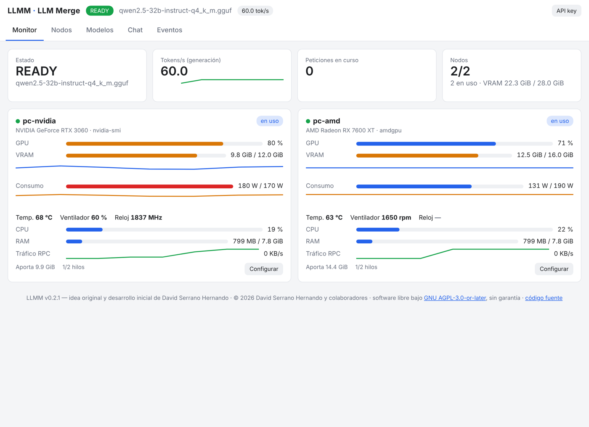

# DLLM · Distributed LLM

[English](README.md) · **Español**

**Ejecuta modelos de lenguaje que no caben en un solo equipo repartiéndolos entre varios ordenadores de tu red**
(portátiles, sobremesas viejos, mini-PCs, Macs…), con o sin GPU.

DLLM es el *plano de control* sobre el motor [`llama.cpp`](https://github.com/ggml-org/llama.cpp) (`rpc-server` +
`llama-server`): descubre los equipos, mide la red, decide qué parte del modelo va a cada uno, lo carga, ofrece una
API compatible con OpenAI (y otra compatible con Ollama en el puerto 11434) y un panel web, y se recupera solo si un equipo se cae. El panel incluye un **monitor en tiempo real** de cada nodo (uso de GPU, VRAM, temperatura,
consumo, CPU, RAM, tráfico, tokens/s) para NVIDIA, AMD, Intel y Apple, y permite configurar cada nodo (capas,
memoria, dispositivo) y cada modelo (contexto, caché K/V, flash attention, temperatura…), como en LM Studio. Desde el
panel se **descargan modelos de Hugging Face y Ollama** (también los
**multimodales** con visión y audio, sin configurar nada aparte) y se ajustan sus parámetros (temperatura, prompt de
sistema…). Puedes mantener **varios modelos cargados a la vez**, elegir **en qué nodos y en qué dispositivo (GPU o CPU)** corre cada uno y ver los recursos del clúster antes de cargar (simulación), con **registros** por nivel, modelo y nodo y métricas por modelo; los nodos se pueden **añadir por IP, buscar en la red, medir (uno a uno y en conjunto) y eliminar** desde el panel, y un **modo avanzado** muestra todos los parámetros (un solo endpoint `/v1` que enruta por el campo `model`, con
modelos fijos o cargados bajo demanda) y el reparto tiene en cuenta la **topología de red** (menos saltos entre
equipos). Cada equipo decide **cuánto
comparte** (memoria e hilos), fijándolo él mismo o dejando que lo gestione el orquestador desde el panel, y cuanta más
memoria sume el clúster, **más contexto** puede usar el modelo.

```
  Tu aplicación / navegador
           │  API OpenAI (/v1) · panel web
           ▼
   ┌──────────────────┐   túnel autenticado    ┌──────────────┐
   │   ORQUESTADOR    │ ─────────────────────► │  NODO 1 (GPU)│  capas 1-20
   │  llama-server    │ ─────────────────────► │  NODO 2 (CPU)│  capas 21-32
   │  + scheduler     │ ─────────────────────► │  NODO 3 (CPU)│  capas 33-40
   └──────────────────┘     LAN ≥ 1 Gbps       └──────────────┘
```

> **Estado: demo funcional.** Probado en un clúster real de 2 equipos Windows (AMD Vulkan + NVIDIA) con
> llama.cpp real y un modelo de 31B repartido. El resto (Linux, macOS, CUDA en Linux, varios modelos a la vez,
> `--on-demand`, políticas de dispositivo) solo se ha probado con binarios simulados. **Problema conocido:** enviar una
> imagen a un modelo multimodal grande repartido entre nodos puede reiniciar el modelo (en investigación). Si lo
> pruebas, abre un *issue*. Ver [limitaciones](docs/es/ARQUITECTURA.md#límites).



## Instalación en 3 pasos

**Instalar con una sola orden** (descarga todo lo necesario y abre el asistente):

| Sistema | Orden |
|---|---|
| Linux (Debian/Ubuntu, Fedora/RHEL, Arch, openSUSE, Alpine) y macOS — terminal | `bash <(curl -fsSL https://raw.githubusercontent.com/dasehe/DLLM/main/scripts/install.sh)` |
| Windows — PowerShell | `irm https://raw.githubusercontent.com/dasehe/DLLM/main/scripts/install.ps1 \| iex` |

O a mano:

1. **Consigue el paquete** `dllm-package-<versión>.zip` (se genera con `python scripts/build_package.py`, o desde
   [Releases](https://github.com/dasehe/dllm/releases) cuando haya una publicada) y descomprímelo en cada equipo (es el
   mismo para todos).
2. **En el equipo principal** abre el asistente y elige **Orquestador** (o **Ambos** si también quieres que preste su
   CPU/GPU). Al terminar verás la dirección del panel y un **código de unión** `DLLM1-…`.
3. **En cada equipo que quieras sumar** abre el asistente, elige **Nodo**, pega el código y decide cuánto comparte
   (automático desde el orquestador, o un límite fijo como «33 % del equipo»). Sin código, el equipo aparece en el
   panel del orquestador para **reclamarlo** y se confirma con un código de verificación. El agente detecta solo su GPU
   (NVIDIA, AMD, Intel o Apple) y su VRAM, y se mantiene en la misma versión de llama.cpp que el orquestador.

| Sistema | Abrir el asistente |
|---|---|
| Windows | Doble clic en `Install-DLLM.bat` |
| macOS | Doble clic en `Install-DLLM.command` (si se bloquea: clic derecho → Abrir) |
| Linux | `./install.sh` (navegador si hay escritorio; terminal por SSH) |

Detalles y opciones: [Instalación](docs/es/INSTALACION.md#instalar-con-una-sola-orden).

El asistente elige el backend más rápido para cada equipo (**CUDA** en NVIDIA, también en Linux; Vulkan en AMD/Intel;
Metal en Mac; CPU) y, si falla, prueba el siguiente. Después abre el panel con el acceso directo **DLLM**: en el propio
orquestador no pide contraseña, y el modelo recibe la **fecha y hora del servidor**.
Todo lo pesado (llama.cpp y modelos) va a la **carpeta de DLLM** que elijas en el asistente. En Windows el asistente
abre en el cortafuegos solo los puertos necesarios, limitados a tu red. Para quitarlo hay un programa aparte,
separado del instalador: `Uninstall-DLLM.bat`, `Uninstall-DLLM.command` o `./uninstall.sh` (ofrece una copia previa de la
configuración). Si pierdes un orquestador, el instalador tiene *Restaurar desde una copia*.

Después abre el panel (`http://127.0.0.1:8080` en el orquestador), comprueba que ves los nodos, añade un modelo en
**Añadir modelos** (busca en Hugging Face o escribe un nombre de Ollama, p. ej. `qwen2.5:7b`), elígelo y pulsa
**Cargar**. Guía completa: **[docs/es/INSTALACION.md](docs/es/INSTALACION.md)**.

## Requisitos

- Python 3.9 o superior (los lanzadores ofrecen instalarlo). Sin dependencias externas.
- Equipos en la misma red local, **idealmente cableados a 1 Gbps o más** (el scheduler descarta enlaces < 800 Mbps y prefiere los nodos con mejor enlace: ver *Topología de red* en la arquitectura).
- Modelos en formato **GGUF**: se descargan desde el panel (Hugging Face u Ollama) o se copian a la carpeta de modelos
  del orquestador (por defecto `~/models`).
- Internet durante la instalación para descargar llama.cpp (o una carpeta con llama.cpp ya instalado).

## Idioma / Language

La interfaz se muestra en **inglés por defecto**; cambia a **Español (España)** con el selector de la cabecera del panel,
del instalador o del desinstalador (se recuerda en el navegador). En la terminal: `dllm --lang es …` o `DLLM_LANG=es`. Documentación en inglés: [README.md](README.md) y `docs/`.

## Uso rápido

```bash
dllm status                      # nodos, estado y reparto
dllm plan  qwen2.5-32b-q4.gguf   # simula el reparto sin cargar
dllm load  qwen2.5-32b-q4.gguf --ctx 4096
curl http://127.0.0.1:8080/v1/chat/completions -H 'Content-Type: application/json' \
     -d '{"messages":[{"role":"user","content":"Hola"}]}'
```
Panel, CLI, API, métricas para Prometheus/Zabbix: **[docs/es/USO.md](docs/es/USO.md)**.

## Documentación

| Documento | Contenido |
|---|---|
| [Integraciones](docs/es/INTEGRACIONES.md) | AnythingLLM, Open WebUI y herramientas (function calling) |
| [Instalación](docs/es/INSTALACION.md) | Asistente, instalación desatendida, sin Internet, GPU, cortafuegos, desinstalar |
| [Uso](docs/es/USO.md) | Panel web, CLI, API OpenAI, carga de modelos, métricas, ejemplos |
| [Arquitectura](docs/es/ARQUITECTURA.md) | Componentes, flujo, scheduler, puertos, límites |
| [Seguridad](docs/es/SEGURIDAD.md) | Modelo de amenazas, autenticación, recomendaciones de despliegue |
| [Solución de problemas](docs/es/SOLUCION-PROBLEMAS.md) | Errores frecuentes y cómo diagnosticarlos |
| [Desarrollo](docs/es/DESARROLLO.md) | Estructura del código, tests, compilar el paquete, publicar versiones |
| [Hoja de ruta](docs/es/ROADMAP.md) | Visión multimodal y pendientes |
| [CHANGELOG](CHANGELOG.md) | Cambios por versión |
| [CONTRIBUTING](CONTRIBUTING.md) · [NOTICE](NOTICE) · [AUTHORS](AUTHORS.md) | Cómo contribuir, licencia y autoría |

## Qué esperar de rendimiento

Repartir un modelo **amplía el tamaño que puedes ejecutar, no acelera** una conversación: las capas se procesan en
serie y cada equipo añade un salto de red. Si el modelo cabe en un solo equipo, DLLM lo usará solo a él. Como orden
de magnitud, un 70B cuantizado en 3–4 equipos domésticos ronda **1–2 tokens/s**; útil para uso personal y pruebas.

## Seguridad en una línea

Los equipos se autentican con un secreto compartido (HMAC) y los nodos solo aceptan al orquestador, pero **el tráfico
no va cifrado**: úsalo en una red de confianza, una VLAN dedicada o sobre WireGuard. Ver [SEGURIDAD](docs/es/SEGURIDAD.md).

## Licencia y autoría

**DLLM — idea original y desarrollo inicial de David Serrano Hernando.**
© 2026 David Serrano Hernando y colaboradores de DLLM.

Software libre bajo la **[GNU AGPL-3.0-or-later](LICENSE)** con términos adicionales de atribución (ver
[`NOTICE`](NOTICE)): cualquiera puede usarlo, estudiarlo, modificarlo, redistribuirlo y continuar el proyecto,
siempre que lo mantenga bajo la misma licencia (también si lo ofrece como servicio en red), conserve la atribución
al autor original e indique claramente que su versión es modificada.

Las contribuciones son bienvenidas con firma DCO, sin cesión de derechos: ver [CONTRIBUTING.md](CONTRIBUTING.md)
y [AUTHORS.md](AUTHORS.md).
