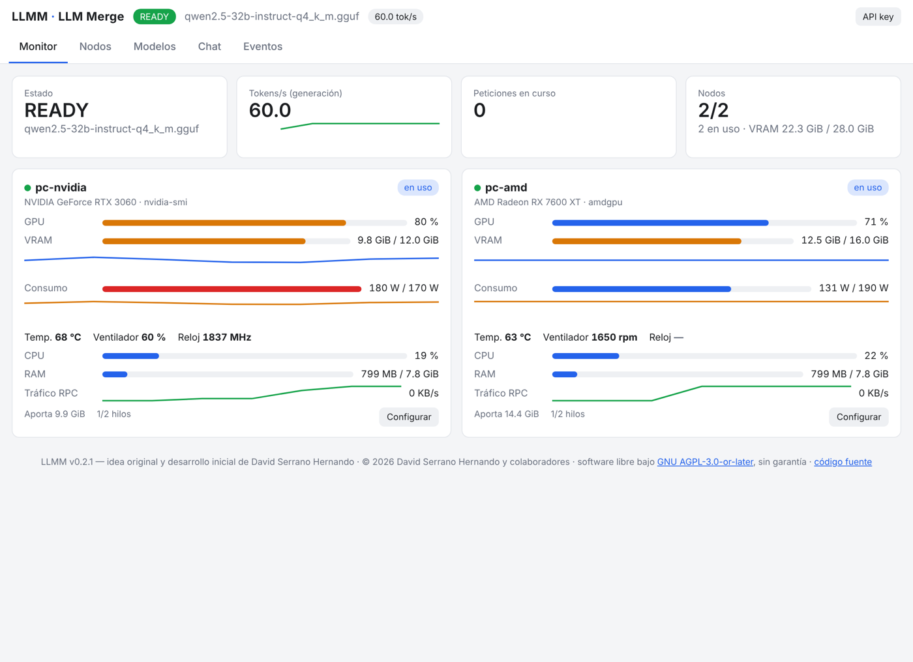

# DLLM · Distributed LLM

**English** · [Español](README.es.md)

**Run language models that do not fit on a single computer by splitting them across several machines on your
network** (laptops, old desktops, mini-PCs, Macs…), with or without a GPU.

DLLM is the *control plane* on top of the [`llama.cpp`](https://github.com/ggml-org/llama.cpp) engine (`rpc-server` +
`llama-server`): it discovers the computers, measures the network, decides which part of the model goes to each one,
loads it, serves an OpenAI-compatible API (and an Ollama-compatible one on port 11434) and a web panel, and recovers on its own if a computer drops. The panel
includes a **real-time monitor** of every node (GPU usage, VRAM, temperature, power, CPU, RAM, traffic, tokens/s) for
NVIDIA, AMD, Intel and Apple, and lets you configure each node (layers, memory, device) and each model (context, K/V
cache, flash attention, temperature…), like LM Studio. From the panel you **download models from Hugging Face and
Ollama** (including **multimodal** ones with vision and audio, with no extra setup) and tune their parameters
(temperature, system prompt…). You can keep **several models loaded at once**, choose **on which nodes and on which
device (GPU or CPU)** each one runs and see the cluster resources before loading (simulation), with **logs** by level,
model and node and per-model metrics; nodes can be **added by IP, searched on the network, measured (one by one and
together) and removed** from the panel, and an **advanced mode** shows every parameter (a single `/v1` endpoint that
routes by the `model` field, with pinned or on-demand models). Splitting takes the **network topology** into account
(fewer hops between computers). Each computer decides **how much it shares** (memory and threads), either setting it
itself or letting the orchestrator manage it from the panel, and the more memory the cluster adds up, **the more
context** the model can use.

```
  Your app / browser
           │  OpenAI API (/v1) · web panel
           ▼
   ┌──────────────────┐   authenticated tunnel ┌──────────────┐
   │   ORCHESTRATOR   │ ─────────────────────► │ NODE 1 (GPU) │  layers 1-20
   │  llama-server    │ ─────────────────────► │ NODE 2 (CPU) │  layers 21-32
   │  + scheduler     │ ─────────────────────► │ NODE 3 (CPU) │  layers 33-40
   └──────────────────┘     LAN ≥ 1 Gbps       └──────────────┘
```

> **Status: working demo.** Tested on a real cluster of 2 Windows computers (AMD Vulkan + NVIDIA) with real llama.cpp
> and a 31B model split between them, and on a real cluster with one GPU node and one CPU-only node running two models
> at once. The rest (Linux, macOS, CUDA on Linux, `--on-demand`, device policies, the tool-calling
> paths) has only been tested with simulated binaries. **Known issue:** sending an image to a large multimodal model
> split across nodes may restart the model (under investigation). If you try it, open an *issue*. See
> [limitations](docs/ARCHITECTURE.md#limits).



## Install in 3 steps

**Install with a single command** (downloads everything needed and opens the wizard):

| System | Command |
|---|---|
| Linux (Debian/Ubuntu, Fedora/RHEL, Arch, openSUSE, Alpine) and macOS — terminal | `bash <(curl -fsSL https://raw.githubusercontent.com/dasehe/DLLM/main/scripts/install.sh)` |
| Windows — PowerShell | `irm https://raw.githubusercontent.com/dasehe/DLLM/main/scripts/install.ps1 \| iex` |

Or manually:

1. **Get the package** `dllm-package-<version>.zip` (built with `python scripts/build_package.py`, or from
   [Releases](https://github.com/dasehe/dllm/releases) when one is published) and unzip it on every computer (it is the
   same for all of them).
2. **On the main computer** open the wizard and choose **Orchestrator** (or **Both** if you also want it to lend its
   CPU/GPU). At the end you will see the panel address and a **join code** `DLLM1-…`.
3. **On every computer you want to add** open the wizard, choose **Node**, paste the code and decide how much it shares
   (automatic from the orchestrator, or a fixed limit such as "33 % of the computer"). Without a code, the computer
   appears in the orchestrator's panel to be **claimed** and is confirmed with a verification code. The agent detects
   its GPU (NVIDIA, AMD, Intel or Apple) and VRAM on its own, and stays on the same llama.cpp version as the orchestrator.

| System | Open the wizard |
|---|---|
| Windows | Double-click `Install-DLLM.bat` |
| macOS | Double-click `Install-DLLM.command` (if it is blocked: right-click → Open) |
| Linux | `./install.sh` (browser if there is a desktop; terminal over SSH) |

Details and options: [Installation](docs/INSTALLATION.md#install-with-a-single-command).

The wizard picks the fastest backend for each computer (**CUDA** on NVIDIA, also on Linux; Vulkan on AMD/Intel; Metal
on Mac; CPU) and, if it fails, tries the next one. Then open the panel with the **DLLM** shortcut: on the orchestrator
itself it does not ask for a password, and the model receives the **server's date and time**. Everything heavy
(llama.cpp and models) goes to the **DLLM folder** you choose in the wizard. On Windows the wizard opens only the
required ports in the firewall, limited to your network. Uninstalling is a separate program: `Uninstall-DLLM.bat`,
`Uninstall-DLLM.command` or `./uninstall.sh` (it offers a backup of the configuration first). If you lose an
orchestrator, the installer has *Restore from a backup*.

Then open the panel (`http://127.0.0.1:8080` on the orchestrator), check that you see the nodes, add a model in
**Add models** (search Hugging Face or type an Ollama name, e.g. `qwen2.5:7b`), pick it and press **Load**. Full guide:
**[docs/INSTALLATION.md](docs/INSTALLATION.md)**.

## Requirements

- Python 3.9 or newer (the launchers offer to install it). No external dependencies.
- Computers on the same local network, **ideally wired at 1 Gbps or more** (the scheduler discards links < 800 Mbps
  unless you allow them and prefers the nodes with the best link: see *Network topology* in the architecture).
- Models in **GGUF** format: downloaded from the panel (Hugging Face or Ollama) or copied to the orchestrator's models
  folder.
- Internet during installation to download llama.cpp (or a folder with llama.cpp already installed).

## Language

The interface is shown **in English by default**; switch to **Español (España)** with the selector in the header of the
panel, the installer or the uninstaller (remembered by the browser). In the terminal: `dllm --lang es …` or
`DLLM_LANG=es`. Spanish documentation: [README.es.md](README.es.md) and [`docs/es/`](docs/es/).

## Quick use

```bash
dllm status                      # nodes, state and split
dllm plan  qwen2.5-32b-q4.gguf   # simulates the split without loading
dllm load  qwen2.5-32b-q4.gguf --ctx 4096
curl http://127.0.0.1:8080/v1/chat/completions -H 'Content-Type: application/json' \
     -d '{"messages":[{"role":"user","content":"Hello"}]}'
```
Panel, CLI, API, Prometheus/Zabbix metrics: **[docs/USAGE.md](docs/USAGE.md)**.

## Documentation

| Document | Contents |
|---|---|
| [Integrations](docs/INTEGRATIONS.md) | AnythingLLM, Open WebUI and tools (function calling) |
| [Installation](docs/INSTALLATION.md) | Wizard, unattended install, offline, GPU, firewall, uninstall |
| [Usage](docs/USAGE.md) | Web panel, CLI, OpenAI API, loading models, metrics, examples |
| [Architecture](docs/ARCHITECTURE.md) | Components, flow, scheduler, ports, limits |
| [Security](docs/SECURITY.md) | Threat model, authentication, deployment recommendations |
| [Troubleshooting](docs/TROUBLESHOOTING.md) | Common errors and how to diagnose them |
| [Development](docs/DEVELOPMENT.md) | Code layout, tests, building the package, releasing |
| [Roadmap](docs/ROADMAP.md) | Multimodal vision and pending work |
| [CHANGELOG](CHANGELOG.md) | Changes per version (in Spanish) |
| [CONTRIBUTING](CONTRIBUTING.md) · [NOTICE](NOTICE) · [AUTHORS](AUTHORS.md) | How to contribute, license and authorship |

## What to expect performance-wise

Splitting a model **increases the size you can run, it does not speed up** a conversation: layers are processed in
series and each computer adds a network hop. If the model fits on one computer, DLLM uses only that one (and runs it
directly on the local GPU when possible). As an order of magnitude, a quantized 70B on 3–4 home computers gives around
**1–2 tokens/s**; useful for personal use and testing.

## Security in one line

The panel requires **signing in** (users, groups and roles; API keys per user). Computers authenticate with a shared
secret (HMAC) and nodes only accept the orchestrator, but **traffic is not encrypted**: use it on a trusted network, a dedicated VLAN or over WireGuard. See [SECURITY](docs/SECURITY.md).

## License and authorship

**DLLM — original idea and initial development by David Serrano Hernando.**
© 2026 David Serrano Hernando and DLLM contributors.

Free software under the **[GNU AGPL-3.0-or-later](LICENSE)** with additional attribution terms (see
[`NOTICE`](NOTICE)): anyone may use, study, modify, redistribute and continue the project, as long as they keep it
under the same license (also when offering it as a network service), keep the attribution to the original author and
clearly state that their version is modified.

Contributions are welcome with a DCO sign-off, without copyright assignment: see [CONTRIBUTING.md](CONTRIBUTING.md)
and [AUTHORS.md](AUTHORS.md).
