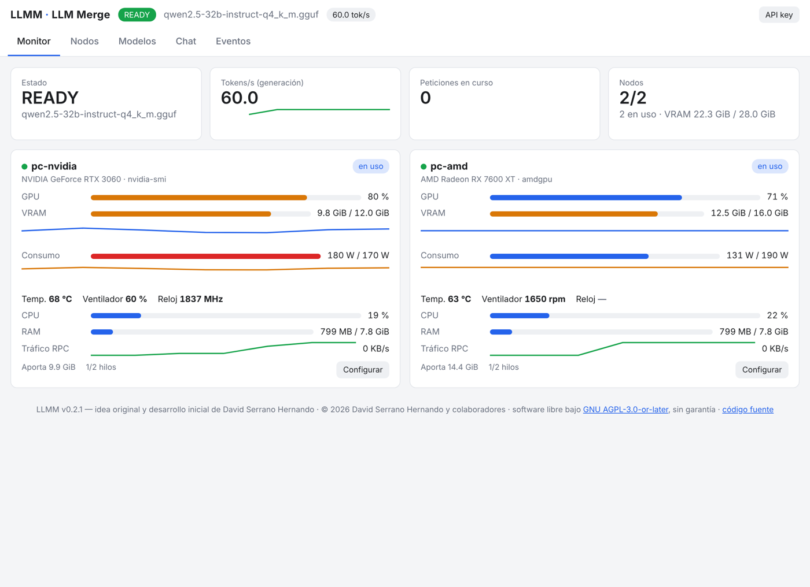
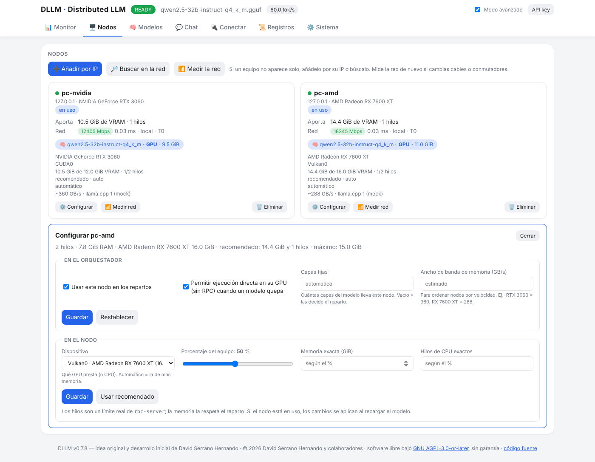
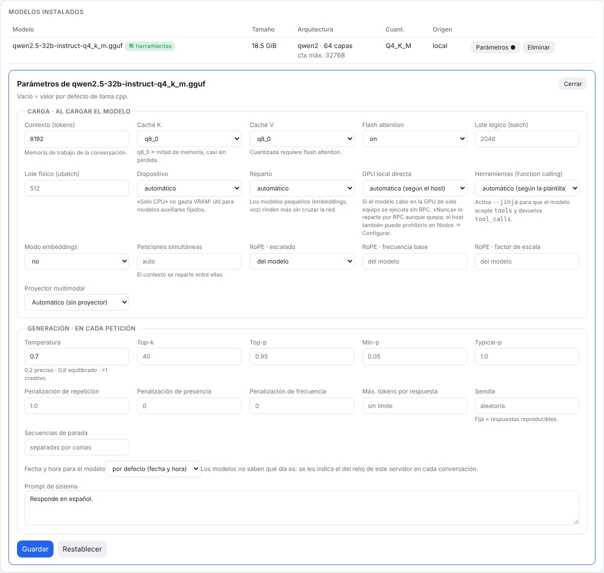

# Usage

**English** · [Español](es/USO.md)

## The `dllm` command

After installing, the program is at `~/.dllm/dllm.pyz`. To type just `dllm`, create an alias:

```bash
# Linux / macOS (add it to ~/.bashrc or ~/.zshrc)
alias dllm='python3 ~/.dllm/dllm.pyz'
```
```powershell
# Windows PowerShell (add it to $PROFILE)
function dllm { py -3 "$env:USERPROFILE\.dllm\dllm.pyz" @args }
```

From source: `python -m dllm …`. Terminal language: English by default; `dllm --lang es …` or `DLLM_LANG=es` for Spanish.

## Web panel

Open it with the **DLLM** shortcut (or `dllm open`): it starts DLLM if stopped, opens **http://127.0.0.1:8080** and hides
the console, which reappears if you close the browser to reopen it or stop DLLM. On the orchestrator itself it asks for
no key. From another computer (if you installed with *expose API*) use the **link for other computers** given by the
wizard or the panel's **API key** button on the orchestrator: it stores the key in that browser. The header shows the
state (`IDLE` without a model, `LOADING`, `READY`, `RECOVERING` if a node dropped and it is reloading, `ERROR`), the loaded
model, live tokens/s, the **Advanced mode** switch and the **language selector** (English / Español (España)).

| Tab | Purpose |
|---|---|
| **Monitor** | Real-time state of the cluster and of each node, with the models loaded on it (see below) |
| **Nodes** | Node cards (loaded models, network, contribution), **Add by IP**, **Search the network**, **🔑 Join code**, **Measure the network**, **Delete**, and **Configure** each one (see [Configuring each node](#configuring-each-node)); **Computers waiting to join** to claim the ones installed without a code ([INSTALLATION](INSTALLATION.md#joining-a-node-without-a-code-claiming-it-from-the-orchestrator)) |
| **Models** | Cluster resources, load or **simulate** a model choosing nodes and GPU/CPU, models in memory, per-model parameters, add from Hugging Face or Ollama, downloads (with a clearable history) (see [Models tab](#models-tab)) |
| **Chat** | Test conversation (with history) against the loaded model; attach image/audio if it is multimodal |
| **Connect** | URL, key and snippets for front-ends; tool test (see [Connect](#connecting-front-ends-and-tools)) |
| **Logs** | What happened, where and why: events with level, model and node, filters and search, last failure with its cause (see [Logs](#logs)) |
| **System** | Backup and restore (see [Backup](#backup-and-recovery)) |
| **Users** | Users, groups, roles and API keys (see [Users](#users-groups-and-roles)) |

### Models tab

From top to bottom:

1. **Cluster resources**: total VRAM, RAM and CPU cores, what loaded models **reserve** and what is free, in total and
   per node (the orchestrator is listed separately if it is not also a node).
2. **Load or simulate a model**. *Target*: **replace the main model** or **add another model at the same time**. *Where
   to run*: **Automatic** (the planner decides) or **Choose nodes and device**: tick the nodes and, on each one, **GPU**
   or **CPU (RAM)**. So a small model can use a specific node's RAM and keep the GPU free for large ones. A node with a
   GPU can use its CPU; "Orchestrator (local RAM)" goes alone (not combined with nodes). **Simulate** loads nothing: it
   computes the split and draws in orange in *Resources* what the model would add.
3. **Models in memory**: one row per model (a "slot" is a memory slot; 0 is the main one). It shows state, **where it
   runs** (node, GPU/CPU, GiB, *direct* when it uses the local GPU without RPC), usage and performance (requests,
   errors, average, p95, tok/s). You can **Cancel** a load in progress, **Unload** the main one or **Delete** any other,
   also if it is in error. If it fails, it links to its log.
4. **Downloads**: progress, speed and remaining time; **Cancel** an active one; **✕** removes a finished one from the
   list and **🧹 Clear history** removes all finished ones (models and resumable partial downloads are not touched).

### Logs

Each event has time, **level** (info, warning, error), model, node and text; it can be filtered by level, model, node and
text. It records loads and their duration, nodes joining and dropping, recoveries, requests with 5xx errors or rejected
(429/503), downloads and every time the join code is viewed. At the top, **Last failure**: code and lines of
`llama-server` and, if an `rpc-server` died, the node's one with its code and lines. They are stored in `events.jsonl`
(configuration folder, rotated at 2 MiB × 3) and survive restarts. Server messages are shown in the panel's language.

**Audit** (below the logs, only with the `audit` permission): every administrative action — any `POST` to `/api/*`
(loading/unloading, model and node settings, adding/forgetting nodes, downloads, backups, users, groups, roles, keys,
own password and keys), viewing the join code, sign-ins (also failed and blocked ones) and sign-outs — with time, user,
credential (`session`, `key:<id>`, `local-token`, `password`), IP, action, parameters and HTTP result. Rejected requests
(401/403) are recorded too. Filter by user, text or *only rejected or failed*. It is stored separately in
`audit.jsonl` (configuration folder, permissions 600, append-only, rotated at 5 MiB × 5) **without secrets**: passwords,
keys, tokens, passphrases and backup contents are replaced by `***`. Read-only queries and `/v1` chat are not audited.
It is not included in backups.

### Monitor



At the top: state, generation **tokens/s** with its chart, requests in progress (and context usage if llama.cpp
publishes it) and active nodes with the total VRAM in use. Below, one card per node with its GPU and the models loaded
on it, updated every 2–3 s:

| Data | NVIDIA (Windows/Linux) | AMD on Linux | AMD/Intel on Windows | Apple | No GPU |
|---|---|---|---|---|---|
| GPU usage | ✓ | ✓ | ✓ | ✓ | — |
| VRAM used / total | ✓ | ✓ | ✓ | memory in use | — |
| Power and limit (W) | ✓ | ✓ | — | — | — |
| Temperature | ✓ | ✓ | — | — | — |
| Fan | ✓ (%) | ✓ (rpm) | — | — | — |
| Clock | ✓ | — | — | — | — |
| CPU, RAM, RPC traffic | ✓ | ✓ | ✓ | ✓ (approx. CPU) | ✓ |

Sources: `nvidia-smi` (one persistent process per node), the amdgpu driver's `sysfs`, the Windows Task Manager counters
(WDDM) and `ioreg`. Windows does not offer temperature or power of AMD/Intel GPUs without the vendor's proprietary
software, so they show as "—". **RPC traffic** measures the data going through the node: if it rises while you
generate, that node is working. Charts keep the last ~5 minutes; the panel only receives new samples each time
(`/api/telemetry?since=`) and stops polling while its tab is hidden. If a node has a GPU that llama.cpp does not use, a
warning explains it (see [TROUBLESHOOTING](TROUBLESHOOTING.md)).

### Users, groups and roles

The panel always asks to **sign in** (also on the orchestrator itself). The installer asks for the **administrator
password** (user `admin`); if it is left empty, the user is `admin` with password `admin` and the panel warns at every
login until it is changed (*👤 → Change password*). Logins with the default password are recorded in *Logs*.

- **Roles** are sets of permissions: `view` (panel, monitor, logs), `chat` (panel chat and `/v1`/Ollama APIs), `models`,
  `nodes`, `system` (backups, join code, settings), `users` (manage users, groups, roles and keys) and `audit`.
  Predefined: *administrator* (everything), *operator* (view, chat, models, nodes), *user* (view, chat), *viewer* (view).
- **Groups** have roles (*administrators*, *operators*, *users*); **users** belong to groups. Everything can be created
  and edited in the **👥 Users** tab (with the `users` permission).
- `admin` cannot be deleted, disabled or removed from *administrators*, and the *administrator* role always keeps every
  permission, so nobody can lock themselves out.
- **API keys belong to a user** and inherit their permissions: *👤 → My API keys* (each user) or the Users tab. They are
  shown only once and stored as a hash. The previous API key in `config.json` becomes an `admin` key.
- Apps on the orchestrator itself (AnythingLLM local…) can still use `/v1` and the Ollama API without a key; from the
  network they need a key with the `chat` permission.
- The terminal (`dllm status`, `load`…) on the orchestrator itself uses a local token (`~/.dllm/local.token`, permissions
  600, only accepted from 127.0.0.1).
- **Request limit per key:** each API key can have a limit of requests per minute (*Limit* button in **👥 Users →
  API keys**, or `"rpm"` when creating it); it applies to the panel API, `/v1` and the Ollama API, and when exceeded the
  answer is `429` with `Retry-After`. 0 = no limit (default).
- **Sign-in lockout** (configurable in **👥 Users → Sign-in lockout**): by default 5 failed logins within 300 s block
  the IP for 300 s and, from the network, also the user name (so guessing from many IPs does not help). From the
  orchestrator itself a user is never blocked, so nobody can lock the administrator out remotely.
- Passwords: PBKDF2-HMAC-SHA256; sessions: random
  token in an `HttpOnly`, `SameSite=Strict` cookie, 12 h sliding expiry. Users travel in backups (`users.json`).
- Every administrative action is recorded in the **audit log** (see *Logs*).

### Adding, searching, measuring and deleting nodes

**Advanced mode** switch (header): without it you see the essentials; with it, every technical parameter. It is
remembered by the browser.

| Action | What it does |
|---|---|
| **Add by IP** | IP or name (and agent port, 8765 by default, in advanced mode). If the node already uses the cluster secret it is registered at once; if it is unpaired, pairing starts (verification code, accept on the node); if it is paired with another secret it says so. Useful when broadcast does not arrive (VLAN, VPN, isolated Wi-Fi). Nodes added by IP are remembered across restarts |
| **Search the network** | Scans a **private** range (by default the orchestrator's /24; in advanced mode you choose: `192.168.1.0/24` or `192.168.1.10-50`, max. 1024 addresses) looking for DLLM agents. Shows *free* (Claim), *paired* (Add, in case it is from your cluster) or *already in this cluster* |
| **🔑 Join code** | Shows the `DLLM1-…` code to paste in a node's installer (hidden by default, show/copy). Only when the panel is opened on the orchestrator itself; in a terminal, `dllm join-code` |
| **Measure the network** | Measures **each node separately** (with full bandwidth) and then **all together**, as in a joint job: if the orchestrator's link is shared, the "combined" value drops and you are warned. Repeat it after changing a cable or switch. A single node can also be measured from its card |
| **Use anyway** | A node below the minimum (800 Mbps, `--min-mbps`) is not used in splits. This mode allows it **after confirming**; the plan warns that it is forced mode. "Stop forcing" reverts it. For testing |
| **Delete** | Removes the node from the list (does not uninstall it). Not possible if a model uses it. If it is still alive and announcing, it is ignored for 10 min. Nodes set with `--node` reappear when the orchestrator restarts |

### Configuring each node



**Nodes → Configure**:

| Setting | Where it lives | Effect |
|---|---|---|
| Use this node in splits | Orchestrator | Disabled = nothing is ever assigned to it (still visible in the monitor) |
| Allow direct execution on its GPU | Orchestrator | Only for the orchestrator's own computer: whether models that fit in its GPU run there without RPC (see [Direct local GPU](#direct-local-gpu)) |
| Fixed layers | Orchestrator | How many model layers this node holds; the rest is split automatically. Useful for manual tuning |
| Memory bandwidth | Orchestrator | Ranks nodes by speed (faster ones fill first). E.g.: RTX 3060 = 360, RX 7600 XT = 288 GB/s |
| Device | Node | Which GPU it lends (or CPU). Automatic = the one with most memory |
| Percentage / memory / threads | Node | How much it contributes (see [Managing what each node contributes](#managing-what-each-node-contributes)) |

"Node" settings can only be changed from the panel if the node is in automatic mode. Everything applies to the next
split, or when the model is reloaded if it is in use.

## Models: add, manage and tune

Everything from the orchestrator's panel. Models are stored in its models folder (`hf/…`, `ollama/…` or wherever you
copy them).

### Adding

| Source | How |
|---|---|
| **Hugging Face** | *Add models → Hugging Face*: search (e.g. `qwen2.5 7b instruct`), press *View files* and download the quantization you want. Recommended: **Q4_K_M** or **Q5_K_M**. Split models (`-00001-of-0000N`) download all their parts. |
| **Ollama** (registry) | *Ollama*: type the name as in [ollama.com/library](https://ollama.com/library), e.g. `qwen2.5:7b`. Its default parameters are imported too (temperature, stops, system prompt). |
| **Local Ollama** | *Local Ollama*: lists the models you already have in Ollama **on the orchestrator's computer** and imports them. If they are on the same disk they are linked without using extra space. |
| Manually | Copy the `.gguf` (and its `mmproj-*.gguf` if multimodal) to the models folder. |

Each download shows progress, speed and remaining time, and can be **cancelled**. If you request it again, it **resumes**
where it stopped. Free space is checked before starting; at the end the published sha256 is verified and that the file
is GGUF. Until then it lives as `.part` and does not appear in the list.

**Gated models** on Hugging Face (Llama, Gemma…): accept their terms on the model's page and save your token (`hf_…`, from
huggingface.co/settings/tokens) in *Hugging Face token*. It is stored on the orchestrator with permissions 600 and only
sent to huggingface.co.

Limitation with Ollama: it works with most text models, but some new or multimodal models packaged for Ollama's own
engine cannot be loaded by llama.cpp. In that case, use the GGUF version from Hugging Face.

### Managing

*Installed models* shows size, architecture, layers, maximum context, quantization, source and whether it is
**👁 multimodal** or has **🛠 tools**. **Delete** removes the file (all its parts) and its parameters; the loaded model
cannot be deleted.

### Per-model parameters



**Parameters** button (with ● if it has any saved). Empty = llama.cpp default.

**Load** (applied when loading the model; changing them requires reloading it):

| Parameter | What it does | Guidance |
|---|---|---|
| Context | Working memory of the conversation (tokens) | See "maximum context" in the split |
| K cache / V cache | Type of the context cache | `q8_0` almost halves the context memory with no noticeable loss; `q4_0` reduces it more, with some loss. A quantized V cache requires flash attention |
| Flash attention | Optimized attention (`auto`, `on`, `off`) | `auto` |
| Logical / physical batch | Prompt tokens processed per step (`-b` / `-ub`) | 2048 / 512; higher = faster long prompts and more memory |
| Concurrent requests | Parallel conversations (`-np`) | The context is shared among them |
| Reuse prompt cache | `--cache-reuse N`: reuses KV cache chunks of at least N tokens between requests | 256 for long chats / RAG |
| Draft model · draft tokens | Speculative decoding (`-md`, `--draft-max`): a small model of the same family (same tokenizer) proposes tokens and the large one validates them; it runs on the orchestrator's CPU (`-ngld 0`) and its memory is not counted in the split | A 0.5–1B model of the same family; untested with real models |
| RoPE (scaling, base, factor) | Extend the context beyond the training one | Only if you know what you are doing; the model brings its own |
| Multimodal projector | Vision/audio: automatic, none or a specific one | Automatic |
| Direct local GPU (`local_gpu`) | `auto` / `on` / `off` (see [Direct local GPU](#direct-local-gpu)) | Automatic |
| Tools (`tools`) | `--jinja` for function calling: `auto` (per template), `on`, `off` | Automatic |

The split takes the cache type into account: with `q8_0` roughly twice the context fits.

**Generation** (on every request, without overriding the values the client sends):

| Parameter | What it does | Guidance |
|---|---|---|
| Temperature | Creativity / randomness | 0.2–0.4 precise · 0.7–0.8 balanced · >1 creative |
| Top-k, Top-p, Min-p, Typical-p | Cut unlikely options | Leave empty unless the model recommends others |
| Repetition penalty | Avoids repeating phrases | 1.0–1.15 |
| Presence / frequency penalty | Favor new topics / punish repeated words | 0–0.5 |
| Max. tokens per response | Maximum length | Empty = no limit |
| Seed | Fixed = reproducible answers | Empty = random |
| Stop sequences | Text that cuts the answer | Comma-separated |
| System prompt | Fixed instructions for every conversation | e.g. "Answer in English" |
| Date and time for the model | Gives it the date and time of the **server clock** (`date and time`, `date only` or `do not provide it`) | Default: date and time; models do not know what day it is and tend to invent it |

They apply to **all** requests (panel chat, API and apps such as Open WebUI). What the client sends always wins, and the
system prompt is only added if the conversation has none. Date and time are always added (also if the client brings its
own system prompt), unless disabled. To keep llama.cpp's **prompt cache** useful, the system message only carries the
date (it changes once a day) and the time is appended at the end of the last user message (`(server time: 10:32 …)`);
requests also go with `cache_prompt: true`.

## Multimodal models (vision and audio)

Models with vision or audio (Gemma 3/4, Qwen2.5-VL, Qwen2.5/3-Omni, Pixtral, Voxtral…, per
[llama.cpp's list](https://github.com/ggml-org/llama.cpp/blob/master/docs/multimodal.md)) need a second file, the
**projector** (`mmproj-*.gguf`). DLLM handles it:

- **Hugging Face:** when downloading a model, if the repository has a projector, it is downloaded with it (F16 preferred).
- **Ollama:** its projector layer is downloaded.
- **Manually:** if there is an `mmproj-*.gguf` in the same folder as the model, it is detected.
- **When loading**, it is enabled (`--mmproj`) and the panel chat shows **📎 Attach** to send an image or audio (wav/mp3)
  if the model supports audio, such as Gemma 4 E2B/E4B.

Through the API the OpenAI format is used: parts `{"type": "image_url", "image_url": {"url": "data:image/png;base64,…"}}`
or `{"type": "input_audio", "input_audio": {"data": "<base64>", "format": "wav"}}` in `content`.

The projector runs on the **orchestrator, on CPU** (`--no-mmproj-offload`), it is not split among nodes: it counts in the
orchestrator's RAM (hundreds of MB) and processing an image takes a few seconds. To use a multimodal model as text only,
choose *None* as its projector.

## Command line

| Command | Purpose |
|---|---|
| `dllm setup` | Installation wizard (browser or `--tui`) |
| `dllm open` | Opens the panel (starts DLLM if stopped; `--hide-console` hides the console) |
| `dllm pair` | On a node installed without a code: confirms the orchestrator claiming it |
| `dllm run` | Starts what the configuration says (used by autostart) |
| `dllm status` | State, nodes and current split |
| `dllm plan MODEL [--ctx N]` | Simulates the split without loading anything |
| `dllm load MODEL [--ctx N]` | Loads the model (asynchronous; follow with `status`) |
| `dllm unload` | Unloads the model and frees the nodes |
| `dllm join-code` | Shows the join code (orchestrator). In the panel: Nodes → 🔑 Join code (only on the computer itself). Installed package: `python3 ~/.dllm/dllm.pyz join-code` (Windows: `py %USERPROFILE%\.dllm\dllm.pyz join-code`) |
| `dllm doctor` | Local computer diagnostics |
| `dllm backup export\|import\|inspect [FILE]` | Full backup (encrypted by default) and restore |
| `dllm uninstall [--gui\|--interactive] [--purge] [--models]` | Uninstalls: program, autostart and firewall; with `--purge` also llama.cpp and the configuration; with `--models` the models in the DLLM folder |

Global option: `--lang en|es` before the subcommand. `MODEL` is the path relative to the models folder, e.g.
`qwen/qwen2.5-32b-instruct-q4_k_m.gguf`. `status/plan/load/unload` talk to `http://127.0.0.1:8080` using the local
configuration's API key; for another orchestrator: `--url http://IP:8080 --api-key KEY` (or the `DLLM_API_KEY` variable).

Example of `dllm plan`:
```
model qwen2.5-32b · ctx 4096 · needs 20.7 GiB (KV 1.0 GiB)
  → pc-gamer            10.9 GiB   52.7%  34 layers  [gpu, ~300 GB/s, 941 Mbps, 0.3 ms]
  → mini-pc              9.8 GiB   47.3%  30 layers  [cpu, ~38 GB/s, 938 Mbps, 0.4 ms]
  ✗ laptop-wifi: network 180 Mbps < minimum 800 Mbps
  ≈ 3.1 tok/s (rough estimate)
```

**Context (`--ctx`)**: the model's "working memory" within a conversation. More context = more memory (KV cache, split
among the nodes) and slightly slower answers. The split shows the **maximum context** that fits with the memory the
nodes contribute, capped at what the model supports. Start with 4096 and raise it if you need to.

## Managing what each node contributes

Each node shares memory (RAM, or VRAM if it uses an NVIDIA GPU) and CPU threads. When installing it you choose:

- **Automatic (recommended):** managed by the orchestrator. In the panel, the node's **Configure** button:
  - *Share of the computer:* e.g. 33 % of a computer with 16 GiB and 12 threads → ~5.3 GiB and 4 threads.
  - *Exact memory / threads:* they override the percentage.
  - *Use recommended:* RAM: up to 75 % (not above the free one minus 1 GiB). GPU VRAM: the free one minus 1 GiB (max.
    95 %). Threads: half.
- **Manual:** the limits are set on the node itself and the panel only shows them. To change them, run the wizard again
  on that node, or use `dllm setup --role node --join … --share 33` (or `--mem-gb`, `--threads`).

Threads are a real limit (passed to `rpc-server`). The split respects the memory: the orchestrator never assigns a node
more than it offers. GPU usage can only be limited by memory. If the node is in use, the change applies when the model
is reloaded (**Unload** → **Load**).

## OpenAI-compatible API

Base: `http://127.0.0.1:8080/v1`. DLLM forwards to `llama-server`, so any OpenAI client works (Open WebUI, LibreChat,
Continue, LangChain…). The `model` field chooses among the loaded models; if it is missing or matches none, the main one
answers (see [Several models](#several-models-at-once)).

```bash
curl http://127.0.0.1:8080/v1/chat/completions \
  -H 'Content-Type: application/json' -H 'Authorization: Bearer YOUR_API_KEY' \
  -d '{"messages":[{"role":"user","content":"Explain what a VLAN is in two sentences"}],"stream":false}'
```

```python
from openai import OpenAI
c = OpenAI(base_url="http://127.0.0.1:8080/v1", api_key="YOUR_API_KEY")   # any text if there is no API key
r = c.chat.completions.create(model="local", messages=[{"role": "user", "content": "Hello"}], stream=True)
for chunk in r:
    print(chunk.choices[0].delta.content or "", end="", flush=True)
```

If no model is ready the API answers `503` with the current state. API error messages come in English by default;
`?lang=es` or the `X-DLLM-Lang: es` header returns them in Spanish.

### Ollama-compatible API

For clients that only speak Ollama (Ollama CLI, Open WebUI's Ollama connection, Enchanted, libraries for `ollama`…),
the orchestrator also serves the Ollama API on its own port, **11434** by default (`--ollama-port N`, `0` disables it;
`ollama_port` in the orchestrator section of `config.json`). If a real Ollama already uses that port, DLLM logs a warning
and keeps running without it: choose another port.

| Ollama | What DLLM does |
|---|---|
| `GET /api/tags` · `GET /api/ps` · `POST /api/show` · `GET /api/version` | Loaded models (and installable ones with `--on-demand`), details, capabilities (`completion`, `tools`, `vision`, `embedding`) |
| `POST /api/chat` · `POST /api/generate` | Translated to `/v1/chat/completions` (or `/v1/completions` with `raw`): `options` (temperature, top_p, top_k, min_p, num_predict, stop, seed, penalties), `format` (`json` or a schema), `images`, `tools`/`tool_calls` (arguments as objects). Streaming as NDJSON, like Ollama |
| `POST /api/embed` · `POST /api/embeddings` | Translated to `/v1/embeddings` (model loaded in embeddings mode) |
| `POST /api/pull` | Downloads the model from the Ollama registry into the DLLM models folder (same as *Add models → Ollama*), with progress |
| `create`, `copy`, `delete`, `push`, `blobs` | `501`: manage models from the panel |

Model names: the DLLM name (`ollama/qwen2.5-7b.gguf`), with or without `:latest`, or the Ollama name of a model
downloaded with DLLM (`qwen2.5:7b`). `num_ctx` is ignored: the context is set when loading the model. Requests go through
the same router, per-model parameters, queue and metrics as `/v1`. Security: on loopback it needs no key; if the
orchestrator is exposed, it requires `Authorization: Bearer API_KEY` (many Ollama clients cannot send it: use them on the
orchestrator itself or through a tunnel), and browser requests from another origin are rejected. Tested with simulated
binaries; **not tested yet with real Ollama clients**.

### Control API

| Method and path | Body | Response |
|---|---|---|
| `GET /api/state` | — | Full state (nodes, plan, events) |
| `GET /api/models` | — | Available `.gguf` |
| `GET /api/resources` | — | VRAM, RAM and cores per node and in total, with what loaded models reserve |
| `GET /api/events` | `?level=info\|warn\|error&slot=N&node=NAME&q=text&since=T&limit=300` | Filtered events and `counts` per level |
| `GET /api/audit` | `?user=NAME&q=text&failed=1&since=T&limit=200` (permission `audit`) | Audit entries, newest first |
| `POST /api/plan` | `{"model": "...", "ctx": 4096, "slot": 0\|"new", "targets": [{"node": "DSH", "device": "cpu"}]}` | Plan without loading, with `resources` (cluster after loading it). Empty `targets` = automatic; `device`: `gpu` or `cpu`; `@host` = orchestrator RAM |
| `POST /api/load` | `{"model": "...", "ctx": 4096, "slot": 0\|N\|"new", "pinned": true, "targets": […]}` | `202` with the `slot` used (loading continues in the background) |
| `POST /api/unload` | `{"slot": N}` (optional; without `slot` unloads the main one) | `200`; in any state, and **cancels** a load in progress without waiting |
| `GET /api/hf/search?q=…` · `GET /api/hf/files?repo=…` | — | GGUF model search and a repo's files |
| `POST /api/downloads` | `{"source":"hf","repo":…,"file":…}` · `{"source":"ollama","name":"qwen2.5:7b"}` · `{"source":"ollama-local","name":…}` | `202` with the download |
| `GET /api/downloads` · `POST /api/downloads/cancel` | — · `{"id": "d1"}` | Downloads and progress · cancel |
| `POST /api/downloads/clear` | `{"id": "d1"}` (without `id`: all finished ones) | Removes finished downloads from the history (not the files) |
| `GET /api/ollama/local` | — | Models of the local Ollama installation |
| `POST /api/models/settings` | `{"model": …, "settings": {"temperature": 0.7, …}}` (`{}` = reset) | Saved parameters |
| `POST /api/models/delete` | `{"model": …}` | `409` if it is loaded |
| `GET/POST /api/hf/token` | `{"token": "hf_…"}` (empty = delete) | `{"set": true/false}` |
| `POST /api/node/settings` | `{"node": "IP:8765", "enabled": true, "direct_local": true, "layers": 20, "bw_gbps": 360}` (`null` = automatic) | Node settings on the orchestrator |
| `POST /api/node/settings` | `{"node": "IP:8765", "allow_slow": true, "confirm": true}` | Forced mode for a slow network; without `confirm: true` answers `400` |
| `POST /api/nodes/add` | `{"host": "192.168.1.25", "port": 8765}` | `{"state": "añadido"\|"reclamando", ...}`; with `reclamando` it includes `sas` |
| `GET\|POST /api/nodes/scan` | `{"range": "192.168.1.0/24", "port": 8765}` (optional) | Starts the search / state and `found` (`libre`, `en_cluster`, `otro`) |
| `GET\|POST /api/nodes/bench` | `{"nodes": ["IP:8765"]}` (optional; empty = all) | Starts the one-by-one and combined measurement / state and results |
| `POST /api/nodes/forget` | `{"node": "IP:8765"}` | Removes the node from the list; `409` if a model uses it |
| `GET /api/join-code` | — | Join code for nodes (only from the computer itself; logged) |
| `GET /api/telemetry[?since=t]` | — | Real-time state: tokens/s, requests and, per node, GPU/CPU/RAM/traffic with history and loaded models |
| `POST /api/node/limits` | `{"node": "IP:8765", "share": 33}` or `"mem_gb"`/`"threads"`/`"device"` (`""` = automatic), or `{"node": …, "reset": true}` | Effective limits; `400` with the reason if the node is manual or the value is invalid |
| `POST /api/tools/test` | `{"slot": N}` | Real function-call test against a loaded model |
| `POST /api/backup/export\|preview\|import\|redownload` | see [Backup](#backup-and-recovery) | Full backup and restore |
| `GET /metrics` | — | Prometheus metrics |
| `GET /api/access` | — | Whether the request is local, whether a key is needed and (locally) the link for other computers |
| `POST /api/pair/claim` | `{"host": "IP", "port": 8765}` (`port` only if it is not in `pending`) | Claims a computer from `pending` (in `/api/state`); returns the verification code |
| `POST /api/ui/ping?id=…` · `/api/ui/bye?id=…` · `GET /api/ui/clients` | — | Open panel tabs (used by `dllm open`) |
| `GET /healthz` | — | `200` whenever the process is alive (no API key) |

All of them, except `/` and `/healthz`, require `Authorization: Bearer API_KEY` if an API key is configured and the
request does not come from the computer itself (127.0.0.1). Some state values (`añadido`, `libre`…) are internal
identifiers and stay as they are.

## Metrics (Prometheus / Zabbix)

`GET /metrics` exposes: `dllm_state{state}`, `dllm_node_up{node}`, `dllm_node_cap_bytes{node}`, `dllm_node_net_mbps{node}`,
`dllm_recoveries_total`, `dllm_requests_total`, `dllm_request_errors_total` and, per model,
`dllm_slot_requests_total{slot,model}`, `dllm_slot_errors_total`, `dllm_slot_latency_p95_ms`,
`dllm_slot_tokens_per_second`, `dllm_slot_active_requests`, `dllm_slot_recoveries_total`; per node,
`dllm_node_rpc_restarts_total`, `dllm_node_ram_free_bytes`, `dllm_node_vram_reserved_bytes`, and `dllm_events_total{level}`.

- **Prometheus**: `scrape_configs: [{job_name: dllm, static_configs: [{targets: ['IP:8080']}], authorization: {credentials: API_KEY}}]`
- **Zabbix**: *HTTP agent* item to `http://IP:8080/metrics` with header `Authorization: Bearer API_KEY` and dependent
  items with *Prometheus pattern* preprocessing, e.g. `dllm_state{state="READY"}` and `dllm_node_up{node="mini-pc"}`.
  Useful triggers: the `READY` item at 0 for 5 min, a `dllm_node_up` at 0, or `change()` of `dllm_recoveries_total`
  greater than 0.

## Webhook alerts

*System* → **Alerts (webhooks)** sends the events you choose by HTTP `POST` to other applications (Slack, Mattermost,
Discord, n8n, Home Assistant, your own service). Each webhook has a URL (`http://` or `https://`, no user/password in
it), a **format** (`generic`: JSON `{"source","version","origin","event":{t,level,kind,msg,node,slot,detail}}`;
`slack`: `{"text"}`, also Mattermost/Rocket.Chat; `discord`: `{"content"}`), a **minimum level** (all, warnings and
errors — default —, only errors) and optional **types** (`load, unload, node, net, security, backup, request, route,
tools, download`; empty = all). **Test** sends a test event and shows the HTTP result; *Pause*, *New secret* and delete.

Every delivery is signed so the receiver can check it comes from this orchestrator:

```
X-DLLM-Event: node
X-DLLM-Timestamp: 1764320000
X-DLLM-Signature: sha256=<hex HMAC-SHA256(secret, "<timestamp>.<raw body>")>
```

Check it in the receiver (Python): `hmac.compare_digest(sig, "sha256=" + hmac.new(secret, f"{ts}.".encode() + body,
hashlib.sha256).hexdigest())` and reject old timestamps (e.g. > 5 min). The secret is shown **once** when the webhook is
created (or regenerated) and is stored in `~/.dllm/webhooks.json` (permissions 600, included in backups). Deliveries run
in the background (5 s timeout, 2 retries on network errors, 5xx or 429; no retry on other 4xx), **redirects are not
followed**, the same event repeated within 5 s is sent once and each webhook sends at most 30 events per minute (the rest
are counted as *dropped*). Messages follow the server language. API: `GET /api/webhooks`, `POST /api/webhooks/set`
(`{id?, name, url, format, min_level, kinds, enabled, regenerate}`), `/api/webhooks/delete`, `/api/webhooks/test`
(permission `system`).

## Automatic recovery

If a node **in use** stops responding (10 s) or `llama-server` exits, the orchestrator replans with the remaining nodes
and reloads the model (state `RECOVERING`). If it no longer fits, it stays in `ERROR` and retries only when the set of
nodes changes (e.g. when the dropped computer comes back). Requests in progress during the drop fail.

## Performance tips

- Cable and the same switch. Avoid Wi-Fi and hops between subnets.
- Fewer nodes is better: if a model fits in two, do not add a third.
- Put the models on the orchestrator's SSD: loading sends the weights to each node over the network (30 GB at 1 Gbps ≈
  4–5 min).
- If the split does not match reality (e.g. a CPU performing better than estimated), adjust in the wizard *bandwidth*
  (`--bw-gbps`) or *memory to offer* (`--mem-gb`).
- Q4_K_M/Q5_K_M quantizations give the best quality/size balance.

### Direct local GPU

If a model fits entirely in the GPU of a node **on this same computer**, DLLM launches it there without RPC or tunnel
(`llama-server --device <GPU>`, without `--rpc`): less latency and no network. That GPU is reserved in the resource
ledger, but **the rest of the nodes and the RAM stay free** to load other models at the same time (e.g. a small one on
the local GPU and a large one split among the rest). The slot shows the *direct* tag. If it does not fit or the GPU
cannot be identified, the usual RPC split is used.

**You decide where it is used**, at three levels (the most specific wins):

| Level | Where | Effect |
|---|---|---|
| Model | Models → Parameters → *Direct local GPU* (`local_gpu`) | `auto` (default): per host · `off`: **never** direct, always RPC even if it fits · `on`: **forces** it; if not possible (CPU target, remote node, GPU not visible) the load fails with the reason |
| Host | Nodes → Configure → *Allow direct execution* (`direct_local`, API `/api/node/settings`) | Unticked: that computer never runs directly (models in `auto` go over RPC). Default: allowed |
| Global | `--no-direct-local` at startup | Disables direct execution for every model in `auto` |

Every decision that rules out direct mode is recorded in *Logs*. To not use a computer at all, untick *Use this node in
splits*; to fix where a model runs, use *targets* when loading it.

## Connecting front-ends and tools

The **Connect** tab gives the base URL, the API key and ready-made snippets for AnythingLLM, Open WebUI, curl and
Python; the model list (`/v1/models`) includes their capabilities (`tools`, `vision`, `embeddings`) and **Test** makes a
real function call to check it. DLLM starts `llama-server` with `--jinja` if the model template supports tools (`tools`
setting: `auto`/`on`/`off`), so OpenAI-protocol `tools`/`tool_calls` work as is; **it does not run the tools**: the
front-end does. See [INTEGRATIONS](INTEGRATIONS.md).

## Backup and recovery

*System* → **Create backup** downloads a single `.dllmbak` file (ZIP with sha256 per file; encrypted with
PBKDF2-HMAC-SHA256 + HMAC, standard library only) with: cluster secret, API key, model and node settings, nodes added by
IP, Hugging Face token, users and keys, webhook alerts and the list of installed models with their source. Models are not included (they are
re-downloaded). **Restore backup** shows what it contains and what would change; before applying it, it saves the
current state in `~/.dllm/backups/` (keeps 5). Terminal equivalent: `dllm backup export|inspect|import`. If the restore
changes the secret or the API key, it asks for a restart. On a new computer: installer → *Restore from a backup*.

### Several models at once

Each loaded model takes a *slot* (up to 8) with its own `llama-server` and its `rpc-server`s; each node's memory is
shared among them with a reservation ledger (`ledger` in `/api/state`). Examples:

```bash
dllm load qwen2.5-32b-q4.gguf                         # slot 0, pinned
dllm load nomic-embed.gguf --slot new --on-demand      # new slot, evictable by LRU
curl http://127.0.0.1:8080/v1/embeddings -d '{"model":"nomic-embed.gguf","input":"hello"}' -H 'Content-Type: application/json'
```

- The `/v1/*` proxy routes by the `model` field (also in multipart forms) and by the route's capability: a model with
  the `embeddings: true` setting serves `/v1/embeddings` and not `/v1/chat/completions` (and the other way round → `400`).
  With an unknown name or without `model`, the main model answers.
- `placement` (model setting): `split` spreads across nodes; `node` pins it to a single node; `auto` (default) uses
  `node` for embeddings and `split` for the rest.
- `device_policy` (model setting): `auto`, `gpu_strict`, `cpu_only` (in the orchestrator's RAM, no VRAM),
  `gpu_with_cpu_fallback` (the layers that fit in GPU and the rest on CPU). Margins: `--vram-safety-mb`, `--ram-safety-mb`.
- With memory taken by models in use, the request waits up to `--queue-timeout` s and receives `429` (`Retry-After`); if
  the model does not fit even without the unpinned ones, `503` immediately. Errors in OpenAI format.
- `dllm up --on-demand`: if `model` is a `.gguf` in the models folder and is not loaded, it is loaded when the request
  arrives (the request waits) and, if memory is short, the unpinned models unused for longest are evicted. Pinned ones
  (`pinned`, the default of `/api/load`) are never evicted.
