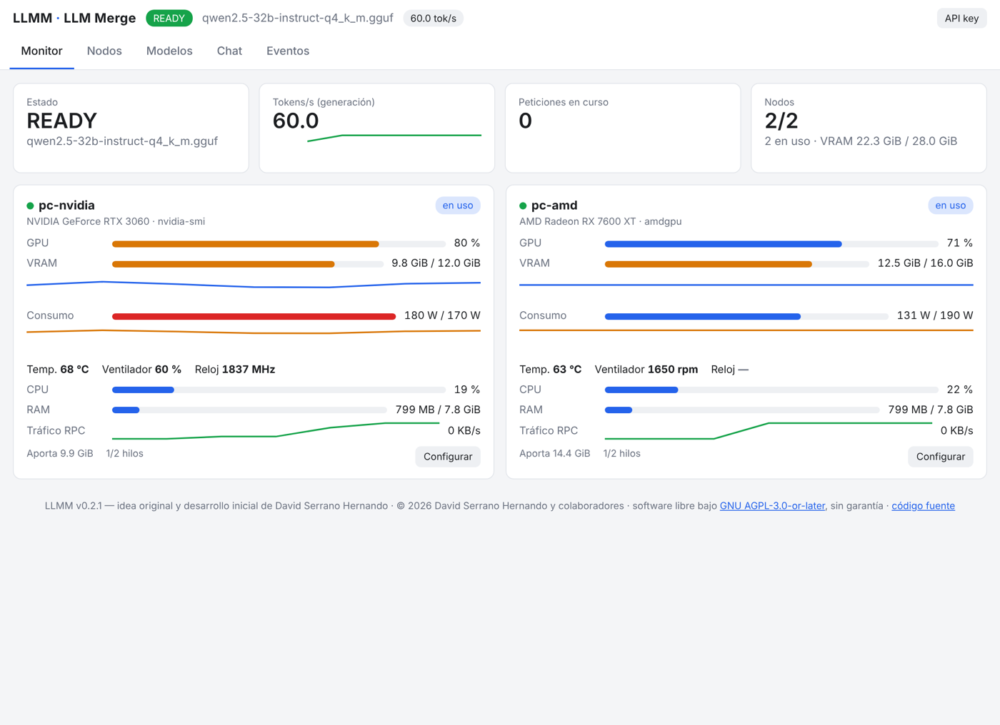
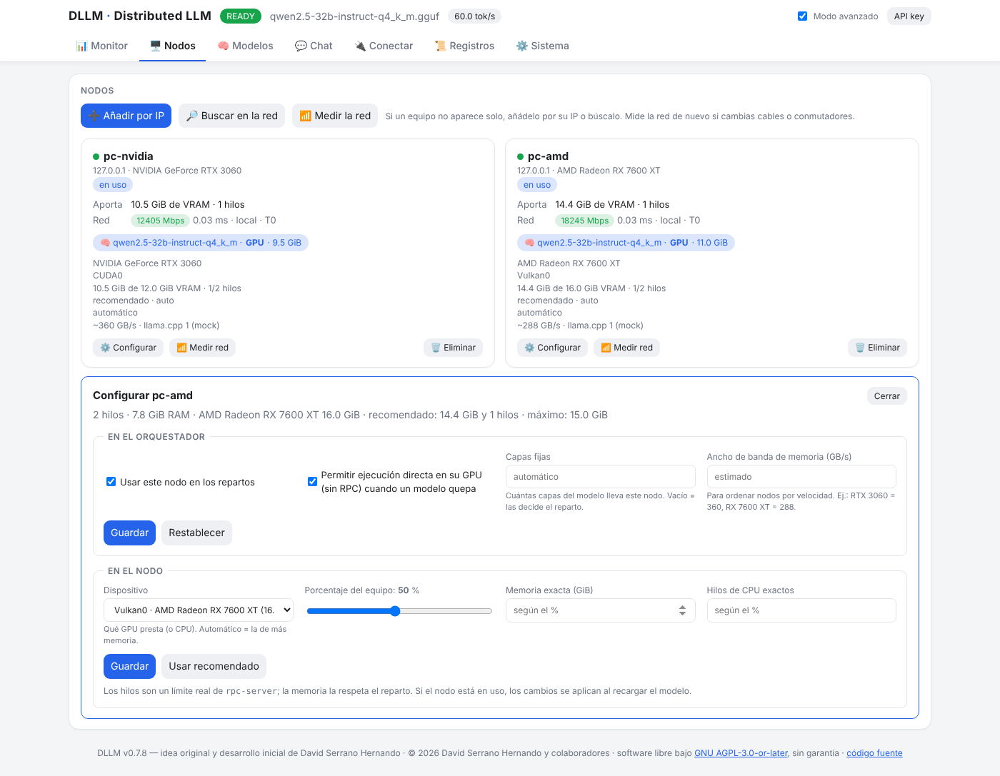
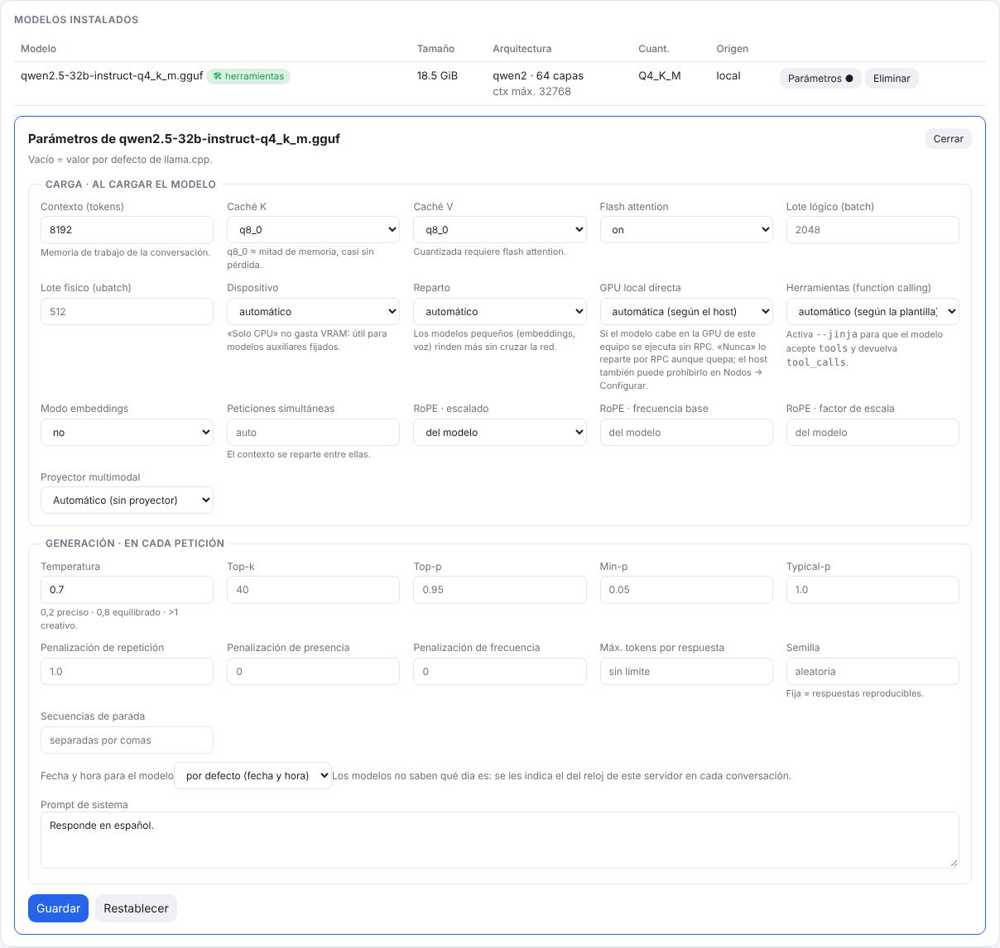

# Uso

[English](../USAGE.md) · **Español**

## El comando `dllm`

Tras instalar, el programa está en `~/.dllm/dllm.pyz`. Para escribir solo `dllm`, crea un alias:

```bash
# Linux / macOS (añádelo a ~/.bashrc o ~/.zshrc)
alias dllm='python3 ~/.dllm/dllm.pyz'
```
```powershell
# Windows PowerShell (añádelo a $PROFILE)
function dllm { py -3 "$env:USERPROFILE\.dllm\dllm.pyz" @args }
```

Desde el código fuente: `python -m dllm …`.

## Panel web

Ábrelo con el acceso directo **DLLM** (o `dllm open`): arranca DLLM si está parado, abre
**http://127.0.0.1:8080** y esconde la consola, que reaparece si cierras el navegador para reabrirlo o parar DLLM.
En el propio orquestador no pide clave. Desde otro equipo (si instalaste con *exponer API*) usa el **enlace para otros
equipos** que da el asistente o el botón **API key** del panel en el orquestador: guarda la clave en ese navegador. La cabecera muestra el estado (`IDLE` sin modelo, `LOADING`,
`READY`, `RECOVERING` si un nodo cayó y se está recargando, `ERROR`), el modelo cargado y los tokens/s en directo.

| Pestaña | Para qué |
|---|---|
| **Monitor** | Estado del clúster y de cada nodo en tiempo real (ver abajo) |
| **Nodos** | Tarjetas de nodo (modelos cargados, red, aporte), **Añadir por IP**, **Buscar en la red**, **Medir la red**, **Eliminar**, y **Configurar** cada uno (ver [Configurar cada nodo](#configurar-cada-nodo)); **Equipos esperando unirse** para reclamar los instalados sin código ([INSTALACION](INSTALACION.md#unir-un-nodo-sin-código-reclamarlo-desde-el-orquestador)) |
| **Modelos** | Recursos del clúster, cargar o **simular** un modelo eligiendo nodos y GPU/CPU, modelos en memoria, parámetros de cada modelo, añadir desde Hugging Face u Ollama (ver [Modelos](#pestaña-modelos)) |
| **Chat** | Conversación de prueba (con historial) contra el modelo cargado; adjunta imagen/audio si es multimodal |
| **Conectar** | URL, clave y fragmentos para front-ends; prueba de herramientas (ver [Conectar](#conectar-front-ends-y-herramientas)) |
| **Registros** | Qué ha pasado, dónde y por qué: eventos con nivel, modelo y nodo, filtros y búsqueda, último fallo con la causa (ver [Registros](#registros)) |
| **Sistema** | Copia de seguridad y restauración (ver [Copia de seguridad](#copia-de-seguridad-y-recuperación)) |
| **Usuarios** | Usuarios, grupos, roles y API keys (ver [Usuarios](#usuarios-grupos-y-roles)) |

### Pestaña Modelos

De arriba abajo:

1. **Recursos del clúster**: VRAM, RAM y núcleos de CPU totales, lo **reservado** por los modelos cargados y lo libre,
   en total y por nodo (el orquestador figura aparte si no es también un nodo).
2. **Cargar o simular un modelo**. *Destino*: **sustituir el modelo principal** o **añadir otro modelo a la vez**.
   *Dónde ejecutar*: **Automático** (el planificador elige) o **Elegir nodos y dispositivo**: marca los nodos y, en cada
   uno, **GPU**, **GPU + RAM** (lo que no cabe en su VRAM va a la RAM del mismo equipo) o **CPU (RAM)**, con
   **deslizantes** para limitar cuánta VRAM y RAM de cada nodo puede usar este modelo y una **prioridad** (qué nodo se
   llena primero). Así un modelo pequeño puede usar la RAM de un nodo concreto y dejar la GPU libre para los grandes.
   «Orquestador (RAM local)» va solo (no se combina con nodos).

   **Primero GPU, luego RAM** (también en *Automático*): el modelo llena primero **todas las GPU** del clúster (GPU1 +
   GPU2 + …) y solo lo que no cabe va a RAM (RAM1 + RAM2 + …), empezando por la de los equipos que ya están en el reparto
   (mismo equipo: sin otro salto de red y por el mismo túnel). Con una **prioridad** puedes pedir que llene antes un nodo
   concreto (su GPU y luego su RAM) que los demás. El plan muestra claramente qué coge de cada equipo (`vAI1 GPU`, `vAI1 RAM (CPU)`, `vAI2 CPU`, con GiB
   y capas). Necesita un llama.cpp reciente cuyo `rpc-server` exponga varios dispositivos (`-d CUDA0,CPU`; el agente lo
   detecta); con uno antiguo el nodo presta solo su GPU. En el propio equipo del orquestador se ejecuta directo con
   `-ngl` (capas en GPU) y el resto en su RAM, sin RPC. Por nodo se puede desactivar (*Usar también su RAM*) o limitar
   (*RAM máxima para modelos*).
   **Simular** no carga nada: calcula el reparto y dibuja en *Recursos* en naranja lo que añadiría el modelo.
   **Plantillas**: *💾 Guardar como plantilla* guarda esta forma de cargar (modelo, contexto, destino, fijado y *Dónde
   ejecutar* con sus deslizantes y prioridades) con un nombre; *▶ Desplegar* la repite con un clic y *Rellenar el
   formulario* la pasa al formulario para retocarla. Terminal: `dllm template list|apply NOMBRE|delete NOMBRE`. API:
   `GET /api/templates`, `POST /api/templates/save|apply|delete` (permiso `models`). Se guardan en
   `~/.dllm/templates.json` y van en las copias de seguridad.
3. **Modelos en memoria**: una fila por modelo (qué es el «slot»: una ranura de memoria; el 0 es el principal).
   Muestra estado, **dónde corre** (nodo, GPU/CPU, GiB), uso y rendimiento (peticiones, errores, media, p95, tok/s).
   Se puede **Cancelar** una carga en curso, **Descargar** el principal o **Eliminar** cualquier otro, también si está
   en error. Si falla, enlaza con su registro.

### Registros

Cada evento lleva hora, **nivel** (info, aviso, error), modelo, nodo y texto; se filtra por nivel, modelo, nodo y
texto. Registra cargas y su duración, altas y caídas de nodos, recuperaciones, peticiones con error 5xx o rechazadas
(429/503) y descargas. Arriba, **Último fallo**: código y líneas de `llama-server` y, si murió un `rpc-server`, el del
nodo con su código y líneas. Se guardan en `events.jsonl` (carpeta de configuración, rota a 2 MiB × 3) y sobreviven a
reinicios.

**Auditoría** (debajo de los registros, solo con el permiso `audit`): cada acción de administración —cualquier `POST` a
`/api/*` (cargar/descargar, ajustes de modelos y nodos, añadir/olvidar nodos, descargas, copias de seguridad, usuarios,
grupos, roles, claves, contraseña y claves propias)—, cada consulta del código de unión, los inicios de sesión (también
los fallidos y bloqueados) y los cierres, con hora, usuario, credencial (`session`, `key:<id>`, `local-token`,
`password`), IP, acción, parámetros y resultado HTTP. También se anotan las peticiones rechazadas (401/403). Se filtra por
usuario, texto o *solo rechazadas o con error*. Se guarda aparte en `audit.jsonl` (carpeta de configuración, permisos 600,
solo se añade, rota a 5 MiB × 5) **sin secretos**: contraseñas, claves, tokens, frases de paso y el contenido de las
copias se sustituyen por `***`. Las consultas de solo lectura y el chat por `/v1` no se auditan. No va en las copias de
seguridad.

### Monitor



Arriba: estado, **tokens/s** de generación con su gráfica, peticiones en curso (y uso del contexto si llama.cpp lo
publica) y nodos activos con la VRAM total en uso. Debajo, una tarjeta por nodo con su GPU, actualizada cada 2–3 s:

| Dato | NVIDIA (Windows/Linux) | AMD en Linux | AMD/Intel en Windows | Apple | Sin GPU |
|---|---|---|---|---|---|
| Uso de GPU | ✓ | ✓ | ✓ | ✓ | — |
| VRAM usada / total | ✓ | ✓ | ✓ | memoria en uso | — |
| Consumo y límite (W) | ✓ | ✓ | — | — | — |
| Temperatura | ✓ | ✓ | — | — | — |
| Ventilador | ✓ (%) | ✓ (rpm) | — | — | — |
| Reloj | ✓ | — | — | — | — |
| CPU, RAM, tráfico RPC | ✓ | ✓ | ✓ | ✓ (CPU aprox.) | ✓ |

Fuentes: `nvidia-smi`, el `sysfs` del driver amdgpu, los contadores del Administrador de tareas de Windows (WDDM) e
`ioreg`. Windows no ofrece temperatura ni consumo de GPUs AMD/Intel sin el software propietario del fabricante, por
eso aparecen como «—». El **tráfico RPC** mide los datos que pasan por el nodo: si sube mientras generas, ese nodo está
trabajando. Las gráficas guardan los últimos ~5 minutos.

### Usuarios, grupos y roles

El panel pide siempre **iniciar sesión** (también en el propio orquestador). El instalador pide la **contraseña del
administrador** (usuario `admin`); si se deja vacía, el usuario es `admin` con contraseña `admin` y el panel avisa en cada
inicio de sesión hasta cambiarla (*👤 → Cambiar contraseña*). Los inicios con la contraseña por defecto quedan en
*Registros*.

- Los **roles** son conjuntos de permisos: `view` (panel, monitor, registros), `chat` (chat del panel y APIs `/v1`/Ollama),
  `models`, `nodes`, `system` (copias, código de unión, ajustes), `users` (gestionar usuarios, grupos, roles y claves) y
  `audit`. Predefinidos: *administrator* (todo), *operator* (view, chat, models, nodes), *user* (view, chat), *viewer*
  (view).
- Los **grupos** tienen roles (*administrators*, *operators*, *users*); los **usuarios** pertenecen a grupos. Todo se crea y
  edita en la pestaña **👥 Usuarios** (con el permiso `users`).
- `admin` no se puede borrar, desactivar ni sacar de *administrators*, y el rol *administrator* conserva siempre todos los
  permisos: nadie puede quedarse fuera.
- Las **API keys pertenecen a un usuario** y heredan sus permisos: *👤 → Mis API keys* (cada usuario) o la pestaña Usuarios.
  Se muestran una sola vez y se guardan como hash. La API key anterior de `config.json` pasa a ser una clave de `admin`.
- Las aplicaciones del propio orquestador (AnythingLLM local…) pueden seguir usando `/v1` y la API Ollama sin clave; desde
  la red necesitan una clave con el permiso `chat`.
- La terminal (`dllm status`, `load`…) en el propio orquestador usa un token local (`~/.dllm/local.token`, permisos 600,
  solo aceptado desde 127.0.0.1).
- **Límite de peticiones por clave:** cada API key puede tener un límite de peticiones por minuto (botón *Límite* en
  **👥 Usuarios → API keys**, o `"rpm"` al crearla); se aplica a la API del panel, `/v1` y la API Ollama y, al superarlo,
  la respuesta es `429` con `Retry-After`. 0 = sin límite (por defecto).
- **Bloqueo de inicio de sesión** (configurable en **👥 Usuarios → Bloqueo de inicio de sesión**): por defecto 5 fallos en
  300 s bloquean la IP 300 s y, desde la red, también el nombre de usuario (probar desde muchas IP no sirve). Desde el
  propio orquestador nunca se bloquea un usuario, para que nadie pueda dejar fuera al administrador desde la red.
- Contraseñas: PBKDF2-HMAC-SHA256; sesiones: token
  aleatorio en una cookie `HttpOnly`, `SameSite=Strict`, caducidad deslizante de 12 h. Los usuarios viajan en las copias
  (`users.json`).
- Cada acción de administración queda en el **registro de auditoría** (ver *Registros*).

### Añadir, buscar, medir y eliminar nodos

Interruptor **Modo avanzado** (cabecera): sin él se ve lo esencial; con él, todos los parámetros técnicos. Se recuerda en el navegador.

| Acción | Qué hace |
|---|---|
| **Añadir por IP** | IP o nombre (y puerto del agente, 8765 por defecto, en modo avanzado). Si el nodo ya usa el secreto del clúster se registra al instante; si está sin emparejar se inicia el emparejamiento (código de verificación, aceptar en el nodo); si está emparejado con otro secreto lo dice. Útil cuando el broadcast no llega (VLAN, VPN, Wi-Fi aislado) |
| **Buscar en la red** | Explora un rango **privado** (por defecto el /24 del orquestador; en modo avanzado se elige: `192.168.1.0/24` o `192.168.1.10-50`, máx. 1024 direcciones) buscando agentes DLLM. Muestra *libre* (Reclamar), *emparejado* (Añadir, por si es de tu clúster) o *ya en este clúster* |
| **Medir la red** | Mide **cada nodo por separado** (con todo el ancho) y luego **todos a la vez**, como en un trabajo conjunto: si el enlace del orquestador se reparte, el valor «en conjunto» cae y se avisa. Repítelo tras cambiar un cable o un conmutador. Un nodo concreto también se mide desde su tarjeta |
| **Usar igualmente** | Un nodo por debajo del mínimo (800 Mbps, `--min-mbps`) no entra en los repartos. Este modo lo permite **tras confirmar**; el plan avisa de que es modo forzado. «Dejar de forzar» lo revierte. Para pruebas |
| **Eliminar** | Quita el nodo de la lista (no lo desinstala). No se puede si un modelo lo usa. Si sigue vivo y anunciándose, se ignora 10 min. Los nodos fijados con `--node` reaparecen al reiniciar el orquestador |

### Actualizar DLLM en los nodos

Cuando un nodo tiene otra versión de DLLM que el orquestador, su tarjeta lo dice con un botón **Actualizar DLLM**, y
*Nodos* muestra **⬆ Actualizar DLLM en los nodos** para todos a la vez. El orquestador envía su propio `dllm.pyz`; el nodo
lo verifica (sha256 y una ejecución de prueba), guarda el anterior y reinicia su agente (los modelos que lo usen se
recuperan solos). Si la versión nueva no aguanta en marcha, el nodo vuelve solo a la anterior; en modo avanzado,
**↩ DLLM anterior** lo hace a mano. Solo en nodos instalados con el paquete (`dllm.pyz`). API:
`POST /api/nodes/update-dllm {"node": ID|"all"}` y `POST /api/nodes/rollback-dllm {"node": ID}` (permiso `nodes`).
Detalles en [ARQUITECTURA](ARQUITECTURA.md).

### Configurar cada nodo



**Nodos → Configurar**:

| Ajuste | Dónde vive | Efecto |
|---|---|---|
| Usar este nodo en los repartos | Orquestador | Desactivado = nunca se le asigna nada (sigue visible en el monitor) |
| Prioridad (0-10) | Orquestador | Los nodos con más prioridad se llenan antes (su GPU y, si hace falta, su RAM); el resto pasa a los demás. 0 = normal (el reparto elige lo más eficiente) |
| Usar también su RAM | Orquestador | Nodos con GPU: lo que no cabe en su VRAM va a su RAM (por defecto sí) |
| RAM máxima para modelos | Orquestador | Nodos con GPU: tope de RAM que se usa junto a su GPU (vacío = la libre menos el margen de seguridad) |
| Permitir actualizar DLLM | Orquestador | Si *Actualizar DLLM* puede enviar la versión de este orquestador al nodo (por defecto sí). El nodo también puede prohibirlo con `--no-dllm-update` |
| Capas fijas | Orquestador | Cuántas capas del modelo lleva este nodo; el resto se reparte solo. Útil para afinar a mano |
| Ancho de banda de memoria | Orquestador | Ordena los nodos por velocidad (los más rápidos se llenan primero). Ej.: RTX 3060 = 360, RX 7600 XT = 288 GB/s |
| Dispositivo | Nodo | Qué GPU presta (o CPU). Automático = la de más memoria |
| Porcentaje / memoria / hilos | Nodo | Cuánto aporta (ver [Gestionar lo que aporta cada nodo](#gestionar-lo-que-aporta-cada-nodo)) |

Los ajustes «del nodo» solo se pueden cambiar desde el panel si el nodo está en modo automático. Todo se aplica en el
siguiente reparto, o al recargar el modelo si está en uso.

## Modelos: añadir, gestionar y ajustar

Todo desde el panel del orquestador. Los modelos se guardan en su carpeta de modelos (`hf/…`, `ollama/…` o donde
los copies tú).

### Añadir

| Origen | Cómo |
|---|---|
| **Hugging Face** | *Añadir modelos → Hugging Face*: busca (p. ej. `qwen2.5 7b instruct`), pulsa *Ver ficheros* y descarga la cuantización que quieras. Recomendado: **Q4_K_M** o **Q5_K_M**. Los modelos troceados (`-00001-of-0000N`) descargan todas sus partes. |
| **Ollama** (registro) | *Ollama*: escribe el nombre como en [ollama.com/library](https://ollama.com/library), p. ej. `qwen2.5:7b`. Se importan también sus parámetros por defecto (temperatura, paradas, prompt de sistema). |
| **Ollama local** | *Ollama local*: lista los modelos que ya tengas en Ollama **en el equipo del orquestador** y los importa. Si están en el mismo disco se enlazan sin ocupar espacio extra. |
| A mano | Copia el `.gguf` (y su `mmproj-*.gguf` si es multimodal) a la carpeta de modelos. |

Cada descarga muestra progreso, velocidad y tiempo restante, y se puede **cancelar**. Si vuelves a pedirla, **se
reanuda** desde donde quedó. Antes de empezar se comprueba que hay espacio libre; al terminar se verifica el sha256
publicado y que el fichero sea GGUF. Hasta entonces vive como `.part` y no aparece en la lista.

**Modelos con acceso restringido** de Hugging Face (Llama, Gemma…): acepta sus condiciones en la página del modelo y
guarda tu token (`hf_…`, de huggingface.co/settings/tokens) en *Token de Hugging Face*. Se guarda en el orquestador con
permisos 600 y solo se envía a huggingface.co.

Limitación con Ollama: funciona con la mayoría de modelos de texto, pero algunos modelos nuevos o multimodales
empaquetados para el motor propio de Ollama no los carga llama.cpp. En ese caso, usa la versión GGUF de Hugging Face.

### Gestionar

*Modelos instalados* muestra tamaño, arquitectura, capas, contexto máximo, cuantización, origen y si es
**👁 multimodal**. **Eliminar** borra el fichero (todas sus partes) y sus parámetros; no deja borrar el modelo cargado.

### Parámetros por modelo



Botón **Parámetros** (con ● si tiene alguno guardado). Vacío = valor por defecto de llama.cpp.

**Carga** (se aplican al cargar el modelo; cambiarlos exige recargarlo). **Guardar y recargar** guarda y vuelve a cargar
el modelo ya cargado en el acto (*recarga en caliente*): las peticiones en curso terminan antes (hasta 120 s), las nuevas
**esperan en cola** en vez de fallar o ir a otro modelo, y el modelo vuelve con los mismos nodos y los ajustes nuevos
(contexto incluido). El botón **⟳ Recargar** de la lista de modelos cargados hace lo mismo sin cambiar nada; API:
`POST /api/reload {"slot": N}`.

| Parámetro | Qué hace | Orientación |
|---|---|---|
| Contexto | Memoria de trabajo de la conversación (tokens) | Ver «contexto máximo» en el reparto |
| Caché K / Caché V | Tipo de la caché de contexto | `q8_0` reduce la memoria del contexto casi a la mitad, sin pérdida apreciable; `q4_0` la reduce más, con algo de pérdida. La caché V cuantizada requiere flash attention |
| Flash attention | Atención optimizada (`auto`, `on`, `off`) | `auto` |
| Lote lógico / físico | Tokens del prompt que se procesan por paso (`-b` / `-ub`) | 2048 / 512; más alto = prompts largos más rápidos y más memoria |
| Peticiones simultáneas | Conversaciones en paralelo (`-np`) | El contexto se reparte entre ellas |
| Reutilizar caché del prompt | `--cache-reuse N`: reutiliza trozos de caché KV de al menos N tokens entre peticiones | 256 para chats largos / RAG |
| Modelo borrador · tokens del borrador | Decodificación especulativa (`-md`, `--draft-max`): un modelo pequeño de la misma familia (mismo tokenizador) propone tokens y el grande los valida; corre en la CPU del orquestador (`-ngld 0`) y su memoria no se cuenta en el reparto | Un modelo de 0,5–1B de la misma familia; sin probar con modelos reales |
| RoPE (escalado, base, factor) | Extender el contexto más allá del de entrenamiento | Solo si sabes lo que haces; el modelo ya trae los suyos |
| Proyector multimodal | Visión/audio: automático, ninguno o uno concreto | Automático |

El reparto tiene en cuenta el tipo de caché: con `q8_0` cabe aproximadamente el doble de contexto.

**Generación** (en cada petición, sin pisar los valores que envíe el cliente):

| Parámetro | Qué hace | Orientación |
|---|---|---|
| Temperatura | Creatividad / aleatoriedad | 0,2–0,4 preciso · 0,7–0,8 equilibrado · >1 creativo |
| Top-k, Top-p, Min-p, Typical-p | Recortan las opciones poco probables | Déjalos vacíos salvo que el modelo recomiende otros |
| Penalización de repetición | Evita que repita frases | 1,0–1,15 |
| Penalización de presencia / frecuencia | Favorecen temas nuevos / castigan palabras repetidas | 0–0,5 |
| Máx. tokens por respuesta | Longitud máxima | Vacío = sin límite |
| Semilla | Fija = respuestas reproducibles | Vacío = aleatoria |
| Secuencias de parada | Texto que corta la respuesta | Separadas por comas |
| Prompt de sistema | Instrucciones fijas para cada conversación | p. ej. «Responde en español» |
| Fecha y hora para el modelo | Le indica la fecha y hora del **reloj del servidor** (`fecha y hora`, `solo la fecha` o `no indicarla`) | Por defecto, fecha y hora: los modelos no saben qué día es y suelen inventarlo |

Se aplican a **todas** las peticiones (chat del panel, API y aplicaciones como Open WebUI). Lo que envía el cliente
siempre manda, y el prompt de sistema solo se añade si la conversación no trae uno. La fecha y hora se añaden
siempre (también si el cliente trae su propio prompt de sistema), salvo que se desactiven. Para que la **caché del
prompt** de llama.cpp sirva, el mensaje de sistema solo lleva la fecha (cambia una vez al día) y la hora se añade al final
del último mensaje del usuario (`(hora del servidor: 10:32 …)`); las peticiones van además con `cache_prompt: true`. El
texto va en el idioma del servidor (inglés por defecto).

## Modelos multimodales (visión y audio)

Los modelos con visión o audio (Gemma 3/4, Qwen2.5-VL, Qwen2.5/3-Omni, Pixtral, Voxtral…, según
[la lista de llama.cpp](https://github.com/ggml-org/llama.cpp/blob/master/docs/multimodal.md)) necesitan un segundo
fichero, el **proyector** (`mmproj-*.gguf`). DLLM lo gestiona solo:

- **Hugging Face:** al descargar un modelo, si el repositorio tiene proyector, se descarga con él (se prefiere F16).
- **Ollama:** se descarga su capa de proyector.
- **A mano:** si hay un `mmproj-*.gguf` en la misma carpeta que el modelo, se detecta.
- **Al cargar**, se activa (`--mmproj`) y el chat del panel muestra **📎 Adjuntar** para enviar una imagen o un
  audio (wav/mp3) si el modelo admite audio, como Gemma 4 E2B/E4B.

Por API se usa el formato de OpenAI: partes `{"type": "image_url", "image_url": {"url": "data:image/png;base64,…"}}`
o `{"type": "input_audio", "input_audio": {"data": "<base64>", "format": "wav"}}` en `content`.

El proyector se ejecuta en el **orquestador, en CPU** (`--no-mmproj-offload`), no se reparte entre los nodos: cuenta
en la RAM del orquestador (cientos de MB) y procesar una imagen tarda unos segundos. Para usar un modelo multimodal
solo como texto, elige *Ninguno* en su proyector.

## Línea de comandos

| Comando | Para qué |
|---|---|
| `dllm setup` | Asistente de instalación (navegador o `--tui`) |
| `dllm open` | Abre el panel (arranca DLLM si está parado; con `--hide-console` esconde la consola) |
| `dllm pair` | En un nodo instalado sin código: confirma el orquestador que lo reclama |
| `dllm run` | Arranca lo que diga la configuración (lo usa el arranque automático) |
| `dllm status` | Estado, nodos y reparto actual |
| `dllm plan MODELO [--ctx N]` | Simula el reparto sin cargar nada |
| `dllm load MODELO [--ctx N]` | Carga el modelo (asíncrono; sigue con `status`) |
| `dllm unload` | Descarga el modelo y libera los nodos |
| `dllm join-code` | Muestra el código de unión (orquestador). En el panel: Nodos → 🔑 Código de unión (solo en el propio equipo). Paquete instalado: `python3 ~/.dllm/dllm.pyz join-code` (Windows: `py %USERPROFILE%\.dllm\dllm.pyz join-code`) |
| `dllm doctor` | Diagnóstico del equipo local |
| `dllm backup export\|import\|inspect [FICHERO]` | Copia de seguridad completa (cifrada por defecto) y restauración |
| `dllm template list\|apply\|delete [NOMBRE]` | Plantillas de despliegue guardadas en el panel (Modelos → Plantillas) |
| `dllm tls status\|enable\|disable [--cert C --key K]` | HTTPS del panel y la API (ver [HTTPS](#https-opcional)) |
| `dllm uninstall [--gui\|--interactive] [--purge] [--models]` | Desinstala: programa, arranque automático y cortafuegos; con `--purge` también llama.cpp y la configuración; con `--models` los modelos de la carpeta de DLLM |

`MODELO` es la ruta relativa a la carpeta de modelos, p. ej. `qwen/qwen2.5-32b-instruct-q4_k_m.gguf`.
`status/plan/load/unload` hablan con `http://127.0.0.1:8080` usando la API key de la configuración local; para otro
orquestador: `--url http://IP:8080 --api-key CLAVE` (o la variable `DLLM_API_KEY`).

Ejemplo de `dllm plan`:
```
modelo qwen2.5-32b · ctx 4096 · necesita 20.7 GiB (KV 1.0 GiB)
  → pc-gamer            10.9 GiB   52.7%  34 capas  [gpu, ~300 GB/s, 941 Mbps, 0.3 ms]
  → mini-pc              9.8 GiB   47.3%  30 capas  [cpu, ~38 GB/s, 938 Mbps, 0.4 ms]
  ✗ portatil-wifi: red 180 Mbps < mínimo 800 Mbps
  ≈ 3.1 tok/s (estimación gruesa)
```

**Contexto (`--ctx`)**: es la "memoria de trabajo" del modelo dentro de una conversación. Más contexto = más memoria
(caché KV, repartida entre los nodos) y respuestas algo más lentas. El reparto muestra el **contexto máximo** que cabe
con la memoria que aportan los nodos, con tope en el que admite el modelo. Empieza con 4096 y sube si lo necesitas.

## Gestionar lo que aporta cada nodo

Cada nodo comparte memoria (RAM, o VRAM si usa GPU NVIDIA) e hilos de CPU. Al instalarlo se elige:

- **Automático (recomendado):** lo gestiona el orquestador. En el panel, botón **Configurar** del nodo:
  - *Porcentaje del equipo:* p. ej. 33 % de un equipo con 16 GiB y 12 hilos → ~5,3 GiB y 4 hilos.
  - *Memoria / hilos exactos:* tienen prioridad sobre el porcentaje.
  - *Usar recomendado:* RAM: hasta el 75 % (sin pasar de la libre menos 1 GiB). VRAM de GPU: la libre menos 1 GiB
    (máx. 95 %). Hilos: la mitad.
- **Manual:** los límites se fijan en el propio nodo y el panel solo los muestra. Para cambiarlos, vuelve a ejecutar el
  asistente en ese nodo, o usa `dllm setup --role node --join … --share 33` (o `--mem-gb`, `--threads`).

Los hilos son un límite real (se pasan a `rpc-server`). La memoria la respeta el reparto: el orquestador nunca asigna
a un nodo más de lo que ofrece. El uso de una GPU solo se puede limitar en memoria. Si el nodo está en uso, el cambio
se aplica al recargar el modelo (**Descargar** → **Cargar**).

## API compatible con OpenAI

Base: `http://127.0.0.1:8080/v1`. DLLM reenvía a `llama-server`, así que vale cualquier cliente de OpenAI
(Open WebUI, LibreChat, Continue, LangChain…). El campo `model` elige entre los modelos cargados; si falta o no
coincide con ninguno, responde el principal (ver [Varios modelos](#varios-modelos-a-la-vez)).

```bash
curl http://127.0.0.1:8080/v1/chat/completions \
  -H 'Content-Type: application/json' -H 'Authorization: Bearer TU_API_KEY' \
  -d '{"messages":[{"role":"user","content":"Explica qué es un VLAN en dos frases"}],"stream":false}'
```

```python
from openai import OpenAI
c = OpenAI(base_url="http://127.0.0.1:8080/v1", api_key="TU_API_KEY")   # cualquier texto si no hay API key
r = c.chat.completions.create(model="local", messages=[{"role": "user", "content": "Hola"}], stream=True)
for chunk in r:
    print(chunk.choices[0].delta.content or "", end="", flush=True)
```

Si no hay modelo listo la API responde `503` con el estado actual.

### API compatible con Ollama

Para clientes que solo hablan Ollama (Ollama CLI, la conexión Ollama de Open WebUI, Enchanted, bibliotecas de
`ollama`…), el orquestador también sirve la API de Ollama en su propio puerto, **11434** por defecto (`--ollama-port N`,
`0` la desactiva; `ollama_port` en la sección del orquestador de `config.json`). Si un Ollama real ya usa ese puerto, DLLM
lo avisa en Registros y sigue sin ella: elige otro puerto.

| Ollama | Qué hace DLLM |
|---|---|
| `GET /api/tags` · `GET /api/ps` · `POST /api/show` · `GET /api/version` | Modelos cargados (y los instalables con `--on-demand`), detalles, capacidades (`completion`, `tools`, `vision`, `embedding`) |
| `POST /api/chat` · `POST /api/generate` | Se traducen a `/v1/chat/completions` (o `/v1/completions` con `raw`): `options` (temperature, top_p, top_k, min_p, num_predict, stop, seed, penalizaciones), `format` (`json` o un esquema), `images`, `tools`/`tool_calls` (argumentos como objetos). Streaming en NDJSON, como Ollama |
| `POST /api/embed` · `POST /api/embeddings` | Se traducen a `/v1/embeddings` (modelo cargado en modo embeddings) |
| `POST /api/pull` | Descarga el modelo del registro de Ollama a la carpeta de modelos de DLLM (igual que *Añadir modelos → Ollama*), con progreso |
| `create`, `copy`, `delete`, `push`, `blobs` | `501`: gestiona los modelos desde el panel |

Nombres de modelo: el de DLLM (`ollama/qwen2.5-7b.gguf`), con o sin `:latest`, o el nombre de Ollama de un modelo
descargado con DLLM (`qwen2.5:7b`). `num_ctx` se ignora: el contexto se fija al cargar el modelo. Las peticiones pasan
por el mismo enrutador, parámetros por modelo, cola y métricas que `/v1`. Seguridad: en loopback no pide clave; si el
orquestador está expuesto, exige `Authorization: Bearer API_KEY` (muchos clientes de Ollama no pueden enviarla: úsalos en
el propio orquestador o por un túnel), y rechaza peticiones de navegador de otro origen. Probado con binarios
simulados; **sin probar aún con clientes reales de Ollama**.

### API de control

| Método y ruta | Cuerpo | Respuesta |
|---|---|---|
| `GET /api/state` | — | Estado completo (nodos, plan, eventos) |
| `GET /api/models` | — | `.gguf` disponibles |
| `GET /api/resources` | — | VRAM, RAM y núcleos por nodo y totales, con lo reservado por los modelos cargados |
| `GET /api/events` | `?level=info\|warn\|error&slot=N&node=NOMBRE&q=texto&since=T&limit=300` | Eventos filtrados y `counts` por nivel |
| `GET /api/audit` | `?user=NOMBRE&q=texto&failed=1&since=T&limit=200` (permiso `audit`) | Entradas de auditoría, de la más reciente a la más antigua |
| `POST /api/plan` | `{"model": "...", "ctx": 4096, "slot": 0\|"new", "targets": [{"node": "DSH", "device": "cpu"}]}` | Plan sin cargar, con `resources` (clúster tras cargarlo). `targets` vacío = automático; `device`: `gpu` o `cpu`; `@host` = RAM del orquestador |
| `POST /api/load` | `{"model": "...", "ctx": 4096, "slot": 0\|N\|"new", "pinned": true, "targets": […]}` | `202` con el `slot` usado (la carga sigue en segundo plano) |
| `POST /api/unload` | `{"slot": N}` (opcional; sin `slot` descarga el principal) | `200`; en cualquier estado, y **cancela** una carga en curso sin esperar |
| `POST /api/reload` | `{"slot": N}` | `202`; recarga en caliente con los ajustes actuales y los mismos nodos: las peticiones en curso terminan y las nuevas esperan en cola (`409` si ya hay una carga en curso) |
| `GET /api/hf/search?q=…` · `GET /api/hf/files?repo=…` | — | Búsqueda de modelos GGUF y ficheros de un repo |
| `POST /api/downloads` | `{"source":"hf","repo":…,"file":…}` · `{"source":"ollama","name":"qwen2.5:7b"}` · `{"source":"ollama-local","name":…}` | `202` con la descarga |
| `GET /api/downloads` · `POST /api/downloads/cancel` | — · `{"id": "d1"}` | Descargas y progreso · cancelar |
| `POST /api/downloads/clear` | `{"id": "d1"}` (sin `id`: todas las terminadas) | Borra del historial las descargas terminadas (no los ficheros) |
| `GET /api/ollama/local` | — | Modelos de la instalación local de Ollama |
| `POST /api/models/settings` | `{"model": …, "settings": {"temperature": 0.7, …}}` (`{}` = restablecer) | Parámetros guardados |
| `POST /api/models/delete` | `{"model": …}` | `409` si está cargado |
| `GET/POST /api/hf/token` | `{"token": "hf_…"}` (vacío = borrar) | `{"set": true/false}` |
| `POST /api/node/settings` | `{"node": "IP:8765", "enabled": true, "layers": 20, "bw_gbps": 360}` (`null` = automático) | Ajustes del nodo en el orquestador |
| `POST /api/node/settings` | `{"node": "IP:8765", "allow_slow": true, "confirm": true}` | Modo forzado para una red lenta; sin `confirm: true` responde `400` |
| `POST /api/nodes/add` | `{"host": "192.168.1.25", "port": 8765}` | `{"state": "añadido"\|"reclamando", ...}`; con `reclamando` incluye `sas` |
| `GET\|POST /api/nodes/scan` | `{"range": "192.168.1.0/24", "port": 8765}` (opcional) | Lanza la búsqueda / estado y `found` (`libre`, `en_cluster`, `otro`) |
| `GET\|POST /api/nodes/bench` | `{"nodes": ["IP:8765"]}` (opcional; vacío = todos) | Lanza la medición uno a uno y en conjunto / estado y resultados |
| `POST /api/nodes/forget` | `{"node": "IP:8765"}` | Elimina el nodo de la lista; `409` si lo usa un modelo |
| `GET /api/join-code` | — | Código de unión para nodos (solo desde el propio equipo; queda en Registros) |
| `GET /api/telemetry[?since=t]` | — | Estado en tiempo real: tokens/s, peticiones y, por nodo, GPU/CPU/RAM/tráfico con historial |
| `POST /api/node/limits` | `{"node": "IP:8765", "share": 33}` o `"mem_gb"`/`"threads"`/`"device"` (`""` = automático), o `{"node": …, "reset": true}` | Límites efectivos; `400` con motivo si el nodo es manual o el valor no es válido |
| `GET /metrics` | — | Métricas Prometheus |
| `GET /api/access` | — | Si la petición es local, si hace falta clave y (en local) el enlace para otros equipos |
| `POST /api/pair/claim` | `{"host": "IP", "port": 8765}` (`port` solo si no está en `pending`) | Reclama un equipo de `pending` (en `/api/state`); devuelve el código de verificación |
| `POST /api/ui/ping?id=…` · `/api/ui/bye?id=…` · `GET /api/ui/clients` | — | Pestañas del panel abiertas (lo usa `dllm open`) |
| `GET /healthz` | — | `200` siempre que el proceso esté vivo (sin API key) |

Todas, salvo `/` y `/healthz`, exigen `Authorization: Bearer API_KEY` si hay API key configurada y la petición no
viene del propio equipo (127.0.0.1).

## Métricas (Prometheus / Zabbix)

`GET /metrics` expone: `dllm_state{state}`, `dllm_node_up{node}`, `dllm_node_cap_bytes{node}`,
`dllm_node_net_mbps{node}`, `dllm_recoveries_total`, `dllm_requests_total`, `dllm_request_errors_total` y, por modelo,
`dllm_slot_requests_total{slot,model}`, `dllm_slot_errors_total`, `dllm_slot_latency_p95_ms`,
`dllm_slot_tokens_per_second`, `dllm_slot_active_requests`, `dllm_slot_recoveries_total`; por nodo,
`dllm_node_rpc_restarts_total`, `dllm_node_ram_free_bytes`, `dllm_node_vram_reserved_bytes`, y `dllm_events_total{level}`.

- **Prometheus**: `scrape_configs: [{job_name: dllm, static_configs: [{targets: ['IP:8080']}], authorization: {credentials: API_KEY}}]`
- **Zabbix**: ítem *HTTP agent* a `http://IP:8080/metrics` con cabecera `Authorization: Bearer API_KEY` y ítems
  dependientes con preprocesado *Prometheus pattern*, p. ej. `dllm_state{state="READY"}` y
  `dllm_node_up{node="mini-pc"}`. Disparadores útiles: el ítem de `READY` a 0 durante 5 min, un `dllm_node_up` a 0,
  o `change()` de `dllm_recoveries_total` mayor que 0.

## HTTPS (opcional)

El panel, la API y la API compatible con Ollama pueden servirse por HTTPS (TLS ≥ 1.2). En el orquestador:

```bash
dllm tls enable                                    # certificado autofirmado (se crea con openssl en ~/.dllm/tls/)
dllm tls enable --cert cert.pem --key clave.pem    # certificado propio (p. ej. de tu CA o de Let's Encrypt)
dllm tls status                                    # estado y huella SHA-256
dllm tls disable
```

y reinicia DLLM (el servicio, o `dllm up … --tls-self-signed` / `--tls-cert … --tls-key …` a mano). El mismo puerto
atiende los dos protocolos: desde la red solo se acepta HTTPS (el HTTP sin cifrar recibe un `301` a `https://`, así
ninguna contraseña viaja en claro), y desde el propio orquestador sigue funcionando HTTP para la terminal, el acceso
directo y las aplicaciones locales. Por HTTPS la cookie de sesión es `Secure`. Con certificado autofirmado el navegador
avisa la primera vez: compara la **huella** (aparece al arrancar en la terminal/registro y en *Sistema → HTTPS*) antes de
aceptarlo. Los clientes de la API (AnythingLLM, Open WebUI…) deben usar entonces `https://IP:8080/v1` y confiar en el
certificado (o usar el de tu CA). El autofirmado necesita `openssl` (Linux/macOS lo traen; en Windows viene con Git for
Windows); dura 825 días e incluye `localhost`, el nombre del equipo, `127.0.0.1` y la IP de la LAN o anunciada. El
tráfico entre el orquestador y los nodos no cambia (autenticado, no cifrado: ver [SEGURIDAD](SEGURIDAD.md)).

## Alertas por webhook

*Sistema* → **Alertas (webhooks)** envía los eventos que elijas por HTTP `POST` a otras aplicaciones (Slack, Mattermost,
Discord, n8n, Home Assistant, tu propio servicio). Cada webhook tiene una URL (`http://` o `https://`, sin usuario ni
contraseña en ella), un **formato** (`generic`: JSON `{"source","version","origin","event":{t,level,kind,msg,node,slot,detail}}`;
`slack`: `{"text"}`, también Mattermost/Rocket.Chat; `discord`: `{"content"}`), un **nivel mínimo** (todo, avisos y
errores —por defecto—, solo errores) y **tipos** opcionales (`load, unload, node, net, security, backup, request, route,
tools, download`; vacío = todos). **Probar** envía un evento de prueba y muestra el resultado HTTP; también *Pausar*,
*Nuevo secreto* y borrar.

Cada envío va firmado para que el receptor compruebe que viene de este orquestador:

```
X-DLLM-Event: node
X-DLLM-Timestamp: 1764320000
X-DLLM-Signature: sha256=<hex HMAC-SHA256(secreto, "<timestamp>.<cuerpo tal cual>")>
```

Comprobación en el receptor (Python): `hmac.compare_digest(firma, "sha256=" + hmac.new(secreto, f"{ts}.".encode() +
cuerpo, hashlib.sha256).hexdigest())`, y rechaza marcas de tiempo antiguas (p. ej. > 5 min). El secreto se muestra **una
vez** al crear (o regenerar) el webhook y se guarda en `~/.dllm/webhooks.json` (permisos 600, va en las copias). Los
envíos van en segundo plano (5 s de espera, 2 reintentos ante errores de red, 5xx o 429; sin reintento ante otros 4xx),
**no se siguen redirecciones**, el mismo evento repetido en 5 s se envía una vez y cada webhook envía como mucho 30
eventos por minuto (el resto se cuentan como *descartados*). Los mensajes siguen el idioma del servidor. API:
`GET /api/webhooks`, `POST /api/webhooks/set` (`{id?, name, url, format, min_level, kinds, enabled, regenerate}`),
`/api/webhooks/delete`, `/api/webhooks/test` (permiso `system`).

## Recuperación automática

Si un nodo **en uso** deja de responder (10 s) o `llama-server` termina, el orquestador replanifica con los nodos que
quedan y vuelve a cargar el modelo (estado `RECOVERING`). Si ya no cabe, queda en `ERROR` y lo reintenta solo cuando
cambie el conjunto de nodos (p. ej. cuando el equipo caído vuelva). Las peticiones en curso durante la caída fallan.

## Consejos de rendimiento

- Cable y mismo switch. Evita Wi-Fi y saltos entre subredes.
- Menos nodos es mejor: si un modelo cabe en dos, no añadas un tercero.
- Pon los modelos en SSD del orquestador: la carga envía los pesos a cada nodo por la red (un 30 GB a 1 Gbps ≈ 4–5 min).
- Si el reparto no refleja la realidad (p. ej. una CPU que rinde más de lo estimado), ajusta en el asistente
  *ancho de banda* (`--bw-gbps`) o *memoria a ofrecer* (`--mem-gb`).
- Cuantizaciones Q4_K_M/Q5_K_M dan el mejor equilibrio calidad/tamaño.

### GPU local directa

Si un modelo cabe entero en la GPU de un nodo **de este mismo equipo**, DLLM lo lanza ahí sin RPC ni túnel
(`llama-server --device <GPU>`, sin `--rpc`): menos latencia y sin pasar por la red. Esa GPU queda reservada en el
libro de recursos, pero **el resto de nodos y la RAM siguen libres** para cargar otros modelos a la vez (p. ej. uno
pequeño en la GPU local y uno grande repartido entre los demás). El slot muestra la etiqueta *directa*. Si no encaja o
no se puede identificar la GPU, usa el reparto RPC de siempre.

**Tú decides dónde se usa**, en tres niveles (el más específico gana):

| Nivel | Dónde | Efecto |
|---|---|---|
| Modelo | Modelos → Parámetros → *GPU local directa* (`local_gpu`) | `auto` (por defecto): según el host · `off`: **nunca** directo, siempre RPC aunque quepa · `on`: **obliga**; si no es posible (destino en CPU, nodo remoto, GPU no visible) la carga falla con el motivo |
| Host | Nodos → Configurar → *Permitir ejecución directa* (`direct_local`, API `/api/node/settings`) | Desmarcado: ese equipo nunca ejecuta en directo (los modelos con `auto` irán por RPC). El valor por defecto es permitido |
| Global | `--no-direct-local` al arrancar | Desactiva el directo para todos los modelos en `auto` |

Cada decisión que descarta el modo directo queda anotada en *Registros*. Para no usar un equipo en absoluto, desmárcalo con
*Usar este nodo en los repartos*; para fijar dónde corre un modelo, usa *destinos* (`targets`) al cargarlo.

## Conectar front-ends y herramientas

La pestaña **Conectar** da la URL base, la API key y fragmentos listos para AnythingLLM, Open WebUI, curl y Python; la
lista de modelos (`/v1/models`) incluye sus capacidades (`tools`, `vision`, `embeddings`) y **Probar** hace una llamada
real de función para comprobarlo. DLLM arranca `llama-server` con `--jinja` si la plantilla del modelo admite
herramientas (ajuste `tools`: `auto`/`on`/`off`), de modo que `tools`/`tool_calls` del protocolo OpenAI funcionan tal
cual; **no ejecuta las herramientas**: lo hace el front-end. Ver [INTEGRACIONES.md](INTEGRACIONES.md).

## Copia de seguridad y recuperación

*Sistema* → **Crear copia** descarga un único fichero `.dllmbak` (ZIP con sha256 por fichero; cifrado con
PBKDF2-HMAC-SHA256 + HMAC, solo biblioteca estándar) con: secreto del clúster, API key, ajustes de modelos y nodos, nodos
añadidos por IP, token de Hugging Face, usuarios y claves, alertas por webhook y la lista de modelos instalados con su origen. Los modelos no se incluyen (se
re-descargan). **Restaurar copia** muestra qué contiene y qué cambiaría; antes de aplicarla guarda el estado actual en
`~/.dllm/backups/` (conserva 5). Equivalente en terminal: `dllm backup export|inspect|import`. Si la restauración cambia
el secreto o la API key, pide reiniciar. En un equipo nuevo: instalador → *Restaurar desde una copia*.

**Copias programadas** (*Sistema* → *🕒 Copias programadas*): cada N horas (1–720, por defecto 24) crea una copia
**siempre cifrada** en la carpeta elegida (ruta absoluta; por defecto `~/.dllm/scheduled-backups`, p. ej. un montaje del
NAS) con permisos 600 y conserva las N más recientes (1–100, por defecto 7). Al activarlas se hace la primera en menos de un minuto;
*Hacer copia ahora* hace una cuando quieras. Solo se borran las copias antiguas creadas por la programación
(`dllm-auto-*.dllmbak`). La contraseña de cifrado se guarda en el orquestador (`~/.dllm/backup_schedule.json`, permisos
600, nunca la devuelve la API) para poder hacerlas sin nadie delante: protege las copias que lleves a otro sitio; apúntala
en lugar seguro, sin ella no se pueden restaurar. Los aciertos y fallos van a *Registros* (tipo `backup`) y, por tanto, a
las alertas por webhook. API: `GET|POST /api/backup/schedule` (`{enabled, every_hours, keep, dir, include_logs,
passphrase}`; contraseña vacía = conservar la actual) y `POST /api/backup/schedule/run` (permiso `system`).

### Varios modelos a la vez

Cada modelo cargado ocupa un *slot* (hasta 8) con su propio `llama-server` y sus `rpc-server`; la memoria de cada nodo se
reparte entre ellos con un libro de reservas (`ledger` en `/api/state`). Ejemplos:

```bash
dllm load qwen2.5-32b-q4.gguf                         # slot 0, fijado
dllm load nomic-embed.gguf --slot new --on-demand      # slot nuevo, expulsable por LRU
curl http://127.0.0.1:8080/v1/embeddings -d '{"model":"nomic-embed.gguf","input":"hola"}' -H 'Content-Type: application/json'
```

- El proxy `/v1/*` enruta por el campo `model` (también en formularios multipart) y por la capacidad de la ruta:
  un modelo con el ajuste `embeddings: true` atiende `/v1/embeddings` y no `/v1/chat/completions` (y al revés → `400`).
  Con un nombre desconocido o sin `model`, responde el modelo principal.
- `placement` (ajuste del modelo): `split` reparte entre nodos; `node` lo fija a un único nodo; `auto` (por defecto) usa
  `node` para embeddings y `split` para el resto.
- `device_policy` (ajuste del modelo): `auto`, `gpu_strict`, `cpu_only` (en la RAM del orquestador, sin VRAM),
  `gpu_with_cpu_fallback` (las capas que quepan en GPU y el resto en CPU). Márgenes: `--vram-safety-mb`, `--ram-safety-mb`.
- Con memoria ocupada por modelos en uso, la petición espera hasta `--queue-timeout` s y recibe `429` (`Retry-After`);
  si el modelo no cabe ni sin los no fijados, `503` inmediato. Errores en formato OpenAI.
- `dllm up --on-demand`: si `model` es un `.gguf` de la carpeta de modelos y no está cargado, se carga al recibir la
  petición (la petición espera) y, si falta memoria, se expulsan los modelos no fijados que llevan más tiempo sin usarse.
  Los fijados (`pinned`, el valor por defecto de `/api/load`) nunca se expulsan.
